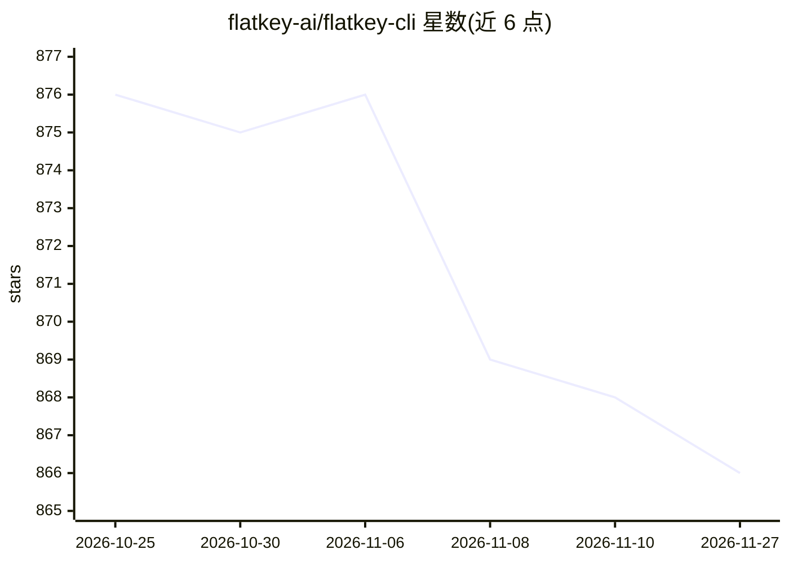

# flatkey-ai/flatkey-cli

⭐ 866 · JavaScript · MIT · 推送 2026-11-25 · [GitHub](https://github.com/flatkey-ai/flatkey-cli) · [官网](https://flatkey.ai/?utm_source=github&utm_medium=repo_homepage&utm_campaign=flatkey_cli) · 组织维护 · 中文 README

**媒体团队的终端媒体生成 CLI：统一密钥与额度生成图/视频/音频/文本**

通过 npm 分发的命令行工具，用户以一个 FLATKEY_API_KEY 与统一积分余额调用图像、视频、TTS、音效、音乐和文本生成命令。图像与视频生成按账号模型目录自动路由或用 --model 指定；支持本地/远程参考图、首尾帧、异步任务查询与下载、--json 机器可读输出、--dry-run 离线预览，并提供面向 Codex/Claude Code/Cursor 等 agent 的接入协议。生成通过 Flatkey 云端路由完成，video copy 功能依赖 CLI 下载的平台深度处理运行时。

## 筛选速览

| 维度 | 判定 | 备注 |
|---|---|---|
| AI 角色 | `ai-ecosystem` | LLM/agent 周边工具 |
| 许可风险 | `permissive` | MIT |
| 部署形态 | `library` | 以包/库形式分发 |
| 模型依赖 | — | README 未给出锁定关系 |
| 硬件要求 | — | 无带数字的原话,不猜 |
| 安装摩擦 | `low` | 无编译、无系统依赖或容器化 |
| 成熟度 | — | 结构信号不足 |

## 能力要点

- 图像/视频/音频/文本生成统一在一个 CLI 与一个积分余额下
- Agent 协议：--json 干净 stdout、--output、--dry-run、模型发现命令
- 视频支持首尾帧、最多 30 张参考图与异步任务恢复
- 模型注册表与 PLG 公开单价查询（models --pricing）

## 适用场景

- 媒体团队用脚本批量生成图片和视频素材
- 把媒体生成接入 AI agent 工作流做重复测试
- 用 TTS/音效/音乐命令生成短视频音频

## 场景标签

`图像生成` `视频生成` `语音合成` · 领域:内容生成

## 证据(README 行号)

> L8: Creative generation from the terminal for media teams and AI agents. Generate images, videos, audio, and text throug
> L299: `models` reads from the Flatkey console model registry. Generation calls use the Flatkey router.
> L303: Use this when wiring Flatkey into Codex, Claude Code, Cursor, or other agents:

## 星数曲线

2026-10-25 876 → 2026-11-27 866（-10）

---
*卡片 v1 · prompt 1.4 · 生成 2026-11-24 · 置信度 high · 依据 README sha `6af8f5ef2394` · [字段定义](../../DATASET.md)*
