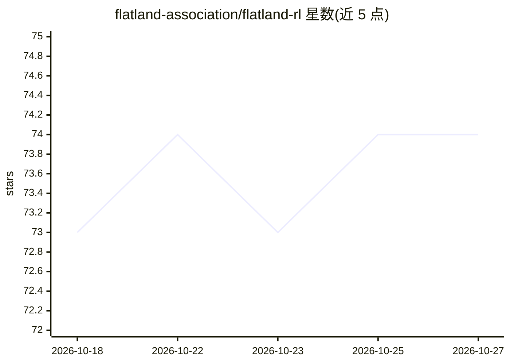

# flatland-association/flatland-rl

⭐ 74 · Jupyter Notebook · MIT · 推送 2026-10-26 · [GitHub](https://github.com/flatland-association/flatland-rl) · [官网](https://flatland-association.github.io/flatland-book/) · 组织维护

**多智能体强化学习算法开发与比较的网格世界环境工具包**

Flatland 是开源的强化学习环境工具包，用于在网格世界（含大规模场景）中开发与比较多智能体强化学习（MARL）算法，围绕不确定性下的弹性资源分配问题设计，方法无关。最初由 SBB、Deutsche Bahn、SNCF 与 AIcrowd 开发，现由 Flatland Association 维护，曾支撑 NeurIPS 2020、AMLD 2021、ECML 2026 等多项竞赛。支持 Python 3.11–3.13，通过 pip 安装；仅发布 sdist，本机构建时若有 C 编译器则自动以 Cython 加速热点模块，否则回退纯 Python。

## 筛选速览

| 维度 | 判定 | 备注 |
|---|---|---|
| AI 角色 | `ai-ecosystem` | LLM/agent 周边工具 |
| 许可风险 | `permissive` | MIT |
| 部署形态 | `library` | 以包/库形式分发 |
| 模型依赖 | — | README 未给出锁定关系 |
| 硬件要求 | — | 无带数字的原话,不猜 |
| 安装摩擦 | `low` | 无编译、无系统依赖或容器化 |
| 成熟度 | — | 结构信号不足 |

## 能力要点

- 网格世界多智能体强化学习环境，方法无关
- 曾支撑 NeurIPS 2020 / AMLD 2021 / ECML 2026 等竞赛
- pip 安装时自动探测 C 编译器并启用 Cython 加速，缺失则回退纯 Python
- 支持 Python 3.11–3.14，覆盖 macOS/Linux/Windows

## 适用场景

- 开发和比较多智能体强化学习算法
- 参加 Flatland 系列挑战赛
- 研究不确定性下的弹性资源分配与运筹优化问题

## 场景标签

`强化学习` · 领域:训练与推理

## 证据(README 行号)

> L7: Flatland is an open-source toolkit for developing and comparing Multi-Agent Reinforcement Learning algorithms in lit
> L8: (or ridiculously large!) gridworlds.

## 星数曲线

2026-10-18 73 → 2026-10-27 74（+1）

---
*卡片 v1 · prompt 1.4 · 生成 2026-10-24 · 置信度 high · 依据 README sha `2c02b52c7cf8` · [字段定义](../../DATASET.md)*
