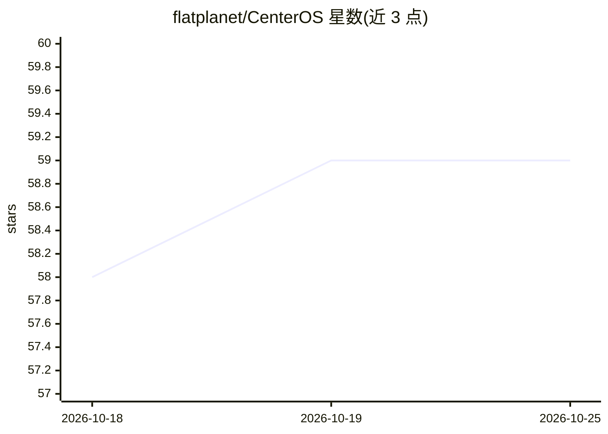

# flatplanet/CenterOS

⭐ 59 · HTML · MIT · 推送 2026-09-01 · [GitHub](https://github.com/flatplanet/CenterOS) · [官网](https://CenterOS.ai) · 个人维护

**给个人/小团队的可克隆 AI 工作系统：让 AI 有持久记忆与工作流**

以纯 Markdown 文件组织的可克隆框架，为 AI 编码工具提供持久工作空间：包含启动/引导文件（STARTUP.md、BOOTSTRAP.md）、跨会话记忆、可复用工作流（每流程独立文件夹、上下文与日志）、可增长的 wiki 知识库、模板与追加式日志，另带轻量 HTML 仪表盘。安装方式为下载 zip 或克隆仓库后，让 AI 读取启动文件完成个性化设置。全部本地存储，无数据库，不依赖特定平台缓存；项目自述处于早期、刻意保持轻量。

## 筛选速览

| 维度 | 判定 | 备注 |
|---|---|---|
| AI 角色 | `ai-ecosystem` | LLM/agent 周边工具 |
| 许可风险 | `permissive` | MIT |
| 部署形态 | `desktop` | 安装包/桌面程序 |
| 模型依赖 | — | README 未给出锁定关系 |
| 硬件要求 | — | 无带数字的原话,不猜 |
| 安装摩擦 | `low` | 无编译、无系统依赖或容器化 |
| 成熟度 | `idea` | |

## 能力要点

- 纯 Markdown 文件组织，无数据库、无平台锁定，可检查与版本管理
- 跨会话持久记忆（memory/MEMORY.md）与用户偏好档案（PRINCIPAL.md）
- 每条工作流独立文件夹、上下文文件与追加式日志
- 克隆后由 AI 运行首次设置并生成个性化系统

## 适用场景

- 让个人 AI 设置跨会话保留记忆与工作规则
- 把重复性工作（写作、研究、会议纪要）固化为可复用工作流
- 与 AI 共同维护可增长的个人知识库

## 场景标签

`Agent 记忆` `工作流自动化` `知识库管理` · 领域:Agent 开发

## 证据(README 行号)

> L14: `CenterOS` is a lightweight, cloneable operating system for working with AI.
> L16: It gives your AI a persistent home: instructions, memory, workflows, wikis, templates, and logs, all organized in p
> L92: - `AGENTS.md` and `CLAUDE.md` - operating rules for AI harnesses.

## 星数曲线

2026-10-18 58 → 2026-10-25 59（+1）

---
*卡片 v1 · prompt 1.4 · 生成 2026-10-24 · 置信度 mid · 依据 README sha `d416f371b9c8` · [字段定义](../../DATASET.md)*
