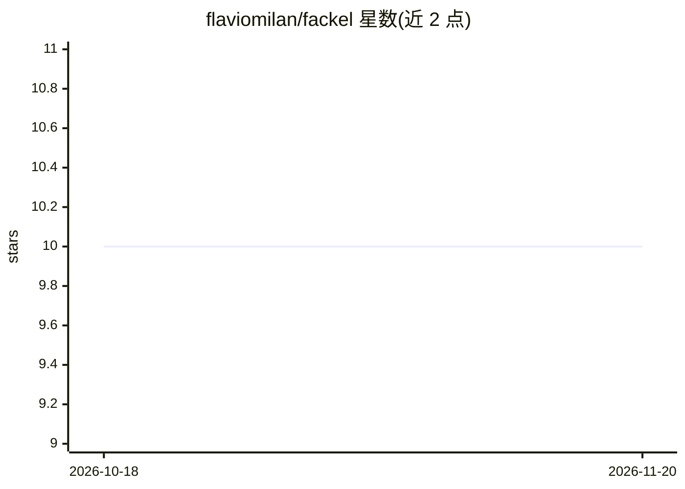

# flaviomilan/fackel

⭐ 10 · Python · Apache-2.0 · 推送 2026-11-13 · [GitHub](https://github.com/flaviomilan/fackel) · 个人维护

**面向安全测试人员的 LLM 多代理渗透测试框架**

Fackel 是一个由 ReAct 代理驱动的多代理渗透测试框架，按 OSINT → 端口扫描 → 漏洞扫描 → 分诊 → 报告五阶段流水线运行，LLM 决定调用哪些工具而非硬编码流程。内置 41 个工具，支持 human-in-the-loop 审批门、LLM-as-a-judge 质量评估与自适应路由、实时终端可观测性，输出控制台简报与归档 Markdown 报告。需要 Python 3.12+ 与 OpenAI API key（默认），活动扫描依赖若干外部二进制。

## 筛选速览

| 维度 | 判定 | 备注 |
|---|---|---|
| AI 角色 | `ai-native` | 本体是模型或模型工具 |
| 许可风险 | `permissive` | Apache-2.0 |
| 部署形态 | `library` | 以包/库形式分发 |
| 模型依赖 | local-ok | 支持本地模型 |
| 硬件要求 | — | 无带数字的原话,不猜 |
| 安装摩擦 | `low` | 无编译、无系统依赖或容器化 |
| 成熟度 | — | 结构信号不足 |

## 能力要点

- 5 阶段流水线（OSINT/端口/漏扫/分诊/报告），41 个工具
- ReAct 代理自主决策工具调用，配 human-in-the-loop 审批门
- LLM-as-a-judge 对各阶段打分并驱动自适应路由
- 支持按代理配置不同模型，Ollama 本地运行可选

## 适用场景

- 对授权目标执行被动 OSINT 侦察并生成报告
- 在 CI 或脚本中做一键扫描与跨扫描差异对比
- 本地 Ollama 模型驱动不外传数据的侦察流程

## 场景标签

`网络安全` `多智能体` · 领域:Agent 开发

## 证据(README 行号)

> L5:  Autonomous pentest framework powered by ReAct agents.
> L16: Fackel is a multi-agent pentest framework where **LLMs decide what to do, not
> L33: |**5-phase pipeline**|OSINT → Port Scan → Vulnerability Scan → Triage → Report. Each phase builds on the previous.|

## 星数曲线

2026-10-18 10 → 2026-11-20 10（+0）

---
*卡片 v1 · prompt 1.4 · 生成 2026-11-19 · 置信度 high · 依据 README sha `d62c2bfd66b9` · [字段定义](../../DATASET.md)*
