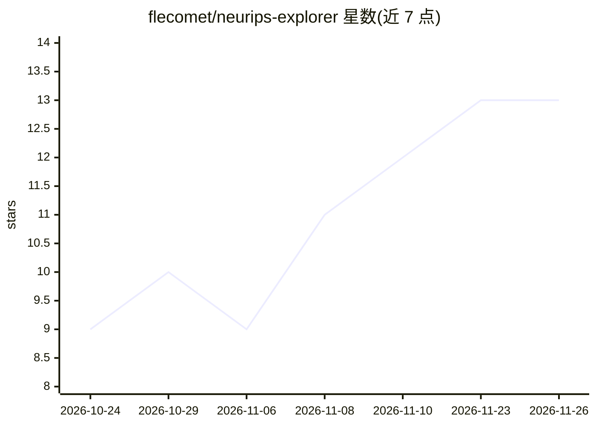

# flecomet/neurips-explorer

⭐ 13 · Python · MIT · 推送 2026-10-13 · [GitHub](https://github.com/flecomet/neurips-explorer) · [官网](https://flecomet.github.io/neurips-explorer/) · 个人维护

**NeurIPS 2026 论文交互式语义地图：聚类浏览与检索 9,110 篇论文**

基于 SPECTER2 标题与摘要嵌入、UMAP 二维投影与 HDBSCAN 聚类，将 9,110 篇 NeurIPS 2026 论文绘制为可交互的 2D 语义地图，TF-IDF 自动生成主题名。提供地图缩放浏览、按地点/报告类型/track 过滤、标题作者关键词全文检索、相似论文推荐、论文收藏导出 CSV/Markdown 与可分享 URL。管线离线运行，站点为纯静态页面，由 GitHub Actions 构建，README 说明 OpenReview 数据源当前不可用、从 neurips.cc 抓取。

## 筛选速览

| 维度 | 判定 | 备注 |
|---|---|---|
| AI 角色 | `ai-knowledge` | 知识聚合/清单类 |
| 许可风险 | `permissive` | MIT |
| 部署形态 | `library` | 以包/库形式分发 |
| 模型依赖 | — | README 未给出锁定关系 |
| 硬件要求 | — | 无带数字的原话,不猜 |
| 安装摩擦 | `low` | 无编译、无系统依赖或容器化 |
| 成熟度 | — | 结构信号不足 |

## 能力要点

- SPECTER2 嵌入 + UMAP + HDBSCAN + TF-IDF 的离线数据处理管线
- 纯静态站点：无后端、无服务期 API key，plotly.js 客户端渲染
- 论文收藏存于浏览器 localStorage，支持 CSV/Markdown 导出
- 固定 random_state 使布局确定性可复现

## 适用场景

- 按主题聚类浏览某届会议的全部录用论文
- 检索论文并查看摘要、TL;DR 与六篇相似论文
- 按作者账号分组整理某研究者的会议论文集
- 导出个人论文清单为 CSV 或 Markdown

## 场景标签

`科研工具` `语义搜索` · 领域:知识与检索

## 证据(README 行号)

> L3: A 2D semantic map of the accepted NeurIPS 2026 papers, built from
> L125: The pipeline is offline and the site is static (no backend, no API keys at serve time).

## 星数曲线

2026-10-24 9 → 2026-11-26 13（+4）

---
*卡片 v1 · prompt 1.4 · 生成 2026-11-18 · 置信度 high · 依据 README sha `c3ec2d59feb4` · [字段定义](../../DATASET.md)*
