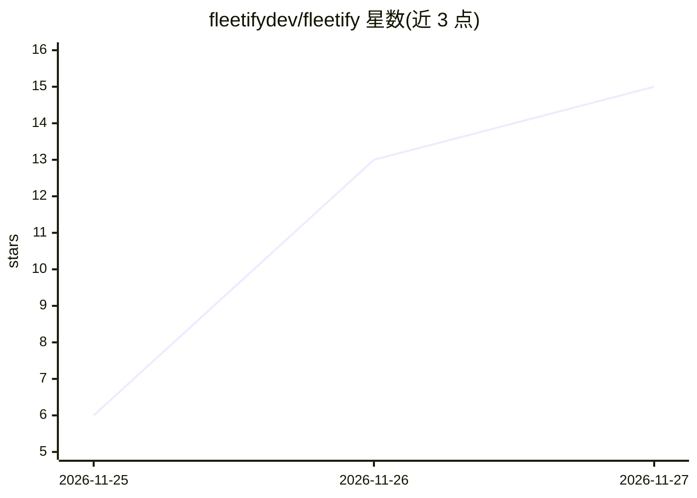

# fleetifydev/fleetify

⭐ 15 · TypeScript · Apache-2.0 · 推送 2026-11-26 · [GitHub](https://github.com/fleetifydev/fleetify) · [官网](https://fleetify.dev) · 组织维护

**在一个桌面应用中并行运行多个 AI 编码代理的控制中心**

基于 Tauri v2 的桌面应用，将 Claude Code、Codex、OpenCode、Cursor CLI、GitHub Copilot CLI 等编码代理 CLI 与 OpenAI、Anthropic、Gemini、OpenRouter、Ollama 等模型 API 汇集到单一窗口：Fleet hub 汇总各会话状态、token 与花费并提供一键停止；每个会话可用独立 git worktree 与分支隔离，内置浏览器与 dev server 预览，支持定时任务、插件市场、MCP sidecar 代理互派任务。需免费账号登录，开发构建可跳过；提交自动附加 Co-Authored-By 署名，可在设置中关闭。

## 筛选速览

| 维度 | 判定 | 备注 |
|---|---|---|
| AI 角色 | `ai-ecosystem` | LLM/agent 周边工具 |
| 许可风险 | `permissive` | Apache-2.0 |
| 部署形态 | `desktop` | 安装包/桌面程序 |
| 模型依赖 | local-ok | 支持本地模型 |
| 硬件要求 | — | 无带数字的原话,不猜 |
| 安装摩擦 | `medium` | 含编译或系统依赖之一 |
| 成熟度 | — | 结构信号不足 |

## 能力要点

- Fleet hub 汇总所有会话的状态、token、花费与一键停止
- 通过 git worktree 隔离并行代理会话并从应用内开 PR
- 插件市场一次安装即可分发给所有支持的 CLI 代理
- 捆绑 MCP sidecar：代理互派任务与驱动无头浏览器

## 适用场景

- 同时运行多个编码代理并行处理不同任务
- 在一个界面跟踪各代理会话的花费与 token 用量
- 用定时例程让代理任务按计划执行
- 为一组代理统一分发提示词、技能、hooks 与规则

## 场景标签

`多智能体` `编码 Agent` · 领域:Agent 开发

## 证据(README 行号)

> L9:  A command center for AI agents.
> L10:  Run Claude Code, Codex, OpenCode and more side by side, from one desktop app.
> L48: Fleetify runs the agent CLIs you already use, such as Claude Code, Codex, OpenCode, Cursor CLI and GitHub Copilot C

## 星数曲线

2026-11-25 6 → 2026-11-27 15（+9）

---
*卡片 v1 · prompt 1.4 · 生成 2026-11-24 · 置信度 high · 依据 README sha `17f67d48a123` · [字段定义](../../DATASET.md)*
