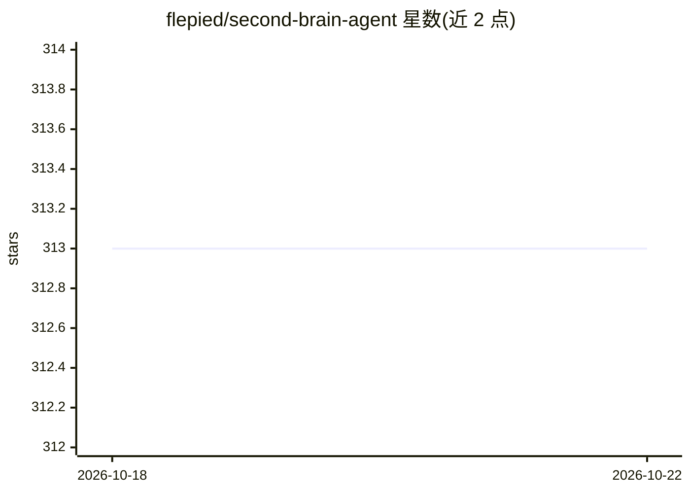

# flepied/second-brain-agent

⭐ 313 · Python · GPL-3.0 · 推送 2026-04-05 · [GitHub](https://github.com/flepied/second-brain-agent) · 个人维护

**个人 Markdown 笔记的自动索引与问答 AI agent**

面向个人知识管理（PKM）的系统：监控 Markdown 笔记目录，自动索引文件内链接的 PDF、网页、YouTube 视频并转为文本，切块后生成向量嵌入存入 ChromaDB（Docker 运行）。基于 LangChain 构建，用 OpenAI LLM 对笔记内容问答；核心接口是 MCP 服务器，暴露 search_documents、get_domains 等工具，可接入 Cursor 等 MCP 客户端；另有 qa.py 命令行检索。支持按文档域（work/personal 等）过滤与 History/Journal 命名约定解析。需 Python 3、uv、inotify-tools，主要在 Fedora/Ubuntu 验证，可用 systemd 服务与 Docker compose 部署。

## 筛选速览

| 维度 | 判定 | 备注 |
|---|---|---|
| AI 角色 | `ai-native` | 本体是模型或模型工具 |
| 许可风险 | `viral` | GPL-3.0 |
| 部署形态 | `library` | 以包/库形式分发 |
| 模型依赖 | — | README 未给出锁定关系 |
| 硬件要求 | — | 无带数字的原话,不猜 |
| 安装摩擦 | `low` | 无编译、无系统依赖或容器化 |
| 成熟度 | — | 结构信号不足 |

## 能力要点

- 自动索引 Markdown 及内链 PDF/网页/YouTube 视频并做向量化
- MCP 服务器提供语义检索、文档计数、域过滤等 4 个工具
- qa.py 命令行对笔记内容问答并输出出处
- History/Journal 日期格式解析与域元数据分类

## 适用场景

- 把 Obsidian 等 Markdown 笔记库变成可问答的第二大脑
- 通过 MCP 客户端（如 Cursor）检索个人笔记上下文
- 按工作/生活域过滤检索个人知识库

## 场景标签

`知识库管理` `文档问答` `语义搜索` · 领域:知识与检索

## 证据(README 行号)

> L34: If you take notes using markdown files like in the Second Brain method or using your own way, this project automati
> L36: The system is built on top of the LangChain framework and the ChromaDB vector store.
> L67: The Second Brain Agent relies on an AI Agent using the Second Brain MCP (Model Context Protocol) server that provid

## 星数曲线

2026-10-18 313 → 2026-10-22 313（+0）

---
*卡片 v1 · prompt 1.4 · 生成 2026-10-21 · 置信度 mid · 依据 README sha `08ef78514f3e` · [字段定义](../../DATASET.md)*
