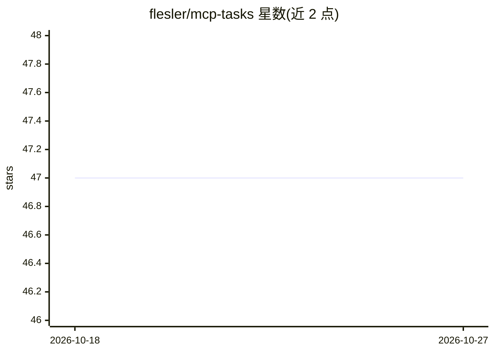

# flesler/mcp-tasks

⭐ 47 · TypeScript · MIT · 推送 2026-08-06 · [GitHub](https://github.com/flesler/mcp-tasks) · 个人维护

**面向 LLM 的 MCP 任务管理服务器：多格式任务文件读写**

基于 Model Context Protocol 的任务管理服务器，提供 5 个工具（setup/search/add/update/summary），让 AI 通过结构化工具调用管理 Markdown/JSON/YAML 格式的任务文件，替代 AI 直接编辑文件的方式。设计目标为减少工具数量、通过批量操作与自动 WIP 管理降低 LLM API 调用与 token 消耗；默认禁止 AI 重写或删除任务。支持 stdio 与 HTTP 传输、多任务文件管理、可自定义工作流状态，并附独立 CLI。要求 Node.js ≥20。

## 筛选速览

| 维度 | 判定 | 备注 |
|---|---|---|
| AI 角色 | `ai-ecosystem` | LLM/agent 周边工具 |
| 许可风险 | `permissive` | MIT |
| 部署形态 | `library` | 以包/库形式分发 |
| 模型依赖 | — | README 未给出锁定关系 |
| 硬件要求 | — | 无带数字的原话,不猜 |
| 安装摩擦 | `low` | 无编译、无系统依赖或容器化 |
| 成熟度 | — | 结构信号不足 |

## 能力要点

- 仅 5 个工具（setup/search/add/update/summary）的结构化任务管理
- Markdown/JSON/YAML 三格式，按扩展名自动检测，可混用
- 默认禁止 AI 重写或删除任务，自动防重复与 WIP 限额管理
- 提供独立 CLI，可用于脚本与 CI/CD 流水线

## 适用场景

- 让 Claude Desktop/Cursor 等 MCP 客户端通过工具调用跟踪任务
- 在 AI 工作过程中从另一终端用 CLI 安全追加任务
- 用自定义状态（如 To Review）组织项目工作流

## 场景标签

 · 领域:LLM 基础设施/MCP 工具

## 证据(README 行号)

> L9: An efficient task manager. Designed to minimize tool confusion and maximize LLM budget efficiency while providing po
> L17: - ⚡ **Ultra-efficient design**: Minimal tool count (5 tools) to reduce AI confusion

## 星数曲线

2026-10-18 47 → 2026-10-27 47（+0）

---
*卡片 v1 · prompt 1.4 · 生成 2026-10-25 · 置信度 high · 依据 README sha `7eeee29af164` · [字段定义](../../DATASET.md)*
