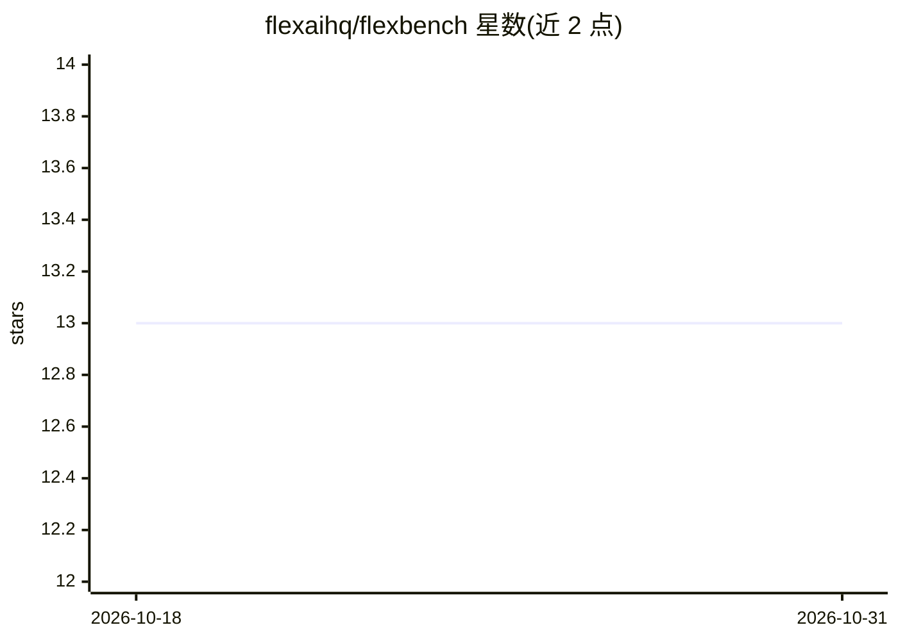

# flexaihq/flexbench

⭐ 13 · Python · Apache-2.0 · 推送 2026-03-12 · [GitHub](https://github.com/flexaihq/flexbench) · 组织维护

**面向 LLM 推理端点的 MLPerf 合规基准测试框架**

FlexBench 是一个文本语言模型基准测试框架，通过 Docker Compose 编排 vLLM 服务容器与压测容器，自动完成模型加载、负载生成与指标采集。支持 MLPerf 标准的 Server/Offline/SingleStream 三种推理场景，自动检测 CUDA/ROCm/ARM/CPU 硬件，提供性能与精度两种评测模式及 QPS 扫描模式；也可通过 --vllm-server 连接已运行的 vLLM 服务。默认使用 cTuning/MLPerf-OpenOrca 数据集，支持自定义数据集。面向需要可复现、结构化评测推理端点的开发与工程人员。

## 筛选速览

| 维度 | 判定 | 备注 |
|---|---|---|
| AI 角色 | `ai-ecosystem` | LLM/agent 周边工具 |
| 许可风险 | `permissive` | Apache-2.0 |
| 部署形态 | `self-host` | docker 或自建部署 |
| 模型依赖 | local-ok | 支持本地模型 |
| 硬件要求 | `cpu-ok` | |
| 安装摩擦 | `low` | 无编译、无系统依赖或容器化 |
| 成熟度 | — | 结构信号不足 |

## 能力要点

- MLPerf 合规的 Server/Offline/SingleStream 三种推理场景
- Docker Compose 自动编排 vLLM 服务与压测容器
- 自动检测 CUDA/ROCm/ARM/CPU 设备类型
- QPS 扫描模式自动发现性能曲线；支持连接外部 vLLM 服务器

## 适用场景

- 对 vLLM 等 OpenAI 兼容推理端点做吞吐与延迟基准测试
- 按 MLPerf 标准复现 Server/Offline/SingleStream 场景评测
- 扫描不同 QPS 水平绘制模型性能曲线

## 场景标签

`模型评测` · 领域:评测与运维

## 证据(README 行号)

> L3: A flexible benchmarking framework for text language models with automated Docker orchestration and MLPerf-compliant 
> L9: - **MLPerf-compliant scenarios** - Server, Offline, and SingleStream inference modes

## 星数曲线

2026-10-18 13 → 2026-10-31 13（+0）

---
*卡片 v1 · prompt 1.4 · 生成 2026-10-31 · 置信度 mid · 依据 README sha `487312e4bfd1` · [字段定义](../../DATASET.md)*
