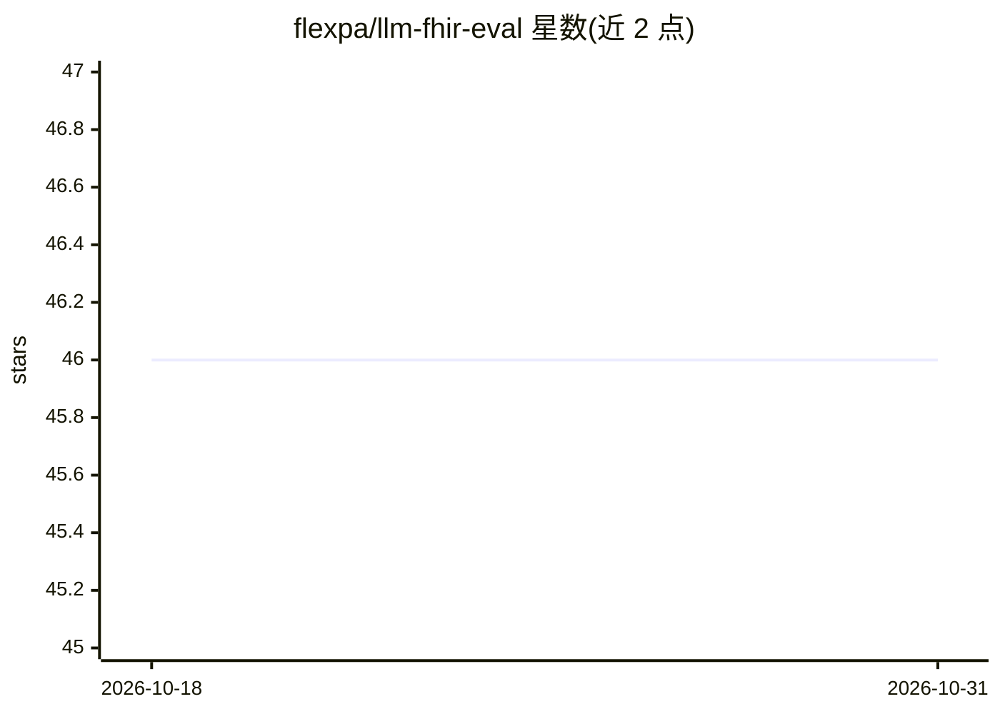

# flexpa/llm-fhir-eval

⭐ 46 · TypeScript · 推送 2026-02-04 · [GitHub](https://github.com/flexpa/llm-fhir-eval) · 组织维护

**面向 FHIR 医疗互操作任务的 LLM 评测框架**

用于对 LLM 在 FHIR（医疗互操作标准）任务上做基准评测的框架，覆盖 FHIR 资源生成、资源校验（$validate）、非结构化临床文本抽取、工具调用四类任务，实现 FHIR-GPT 等已有评测。内置自定义断言（FHIRPath 校验、Bundle 校验等）与带递归工具调用的 Anthropic/OpenAI Provider；支持 GPT-3.5/4.1/O3 与 Claude 系列模型。基于 promptfoo 运行，通过 yarn 安装并配置 API key 后执行评测，指标输出到控制台并可选保存文件。

## 筛选速览

| 维度 | 判定 | 备注 |
|---|---|---|
| AI 角色 | `ai-ecosystem` | LLM/agent 周边工具 |
| 许可风险 | `none` | — |
| 部署形态 | `None` |  |
| 模型依赖 | locked-api |  |
| 硬件要求 | — | 无带数字的原话,不猜 |
| 安装摩擦 | `low` | 无编译、无系统依赖或容器化 |
| 成熟度 | — | 结构信号不足 |

## 能力要点

- 覆盖 FHIR 生成/校验/抽取/工具调用四类评测任务
- 自定义断言：FHIRPath 表达式、Bundle 有效性、元数据元素校验
- 带递归工具调用（最深 10 层）的 Anthropic/OpenAI Provider
- 实现 FHIR-GPT 等先前工作提出的评测

## 适用场景

- 评测不同 LLM 生成合法 FHIR 资源的能力
- 比较各模型从临床文本抽取结构化 FHIR 数据的表现
- 测试模型对 FHIR 校验工具的调用能力

## 场景标签

`模型评测` · 领域:评测与运维

## 证据(README 行号)

> L8: `@flexpa/llm-fhir-eval` is an evaluation framework designed to benchmark the performance of LLMs on FHIR-specific ta
> L12: `@flexpa/llm-fhir-eval` benchmarks FHIR-specific tasks including:

## 星数曲线

2026-10-18 46 → 2026-10-31 46（+0）

---
*卡片 v1 · prompt 1.4 · 生成 2026-10-25 · 置信度 high · 依据 README sha `e0424077dc53` · [字段定义](../../DATASET.md)*
