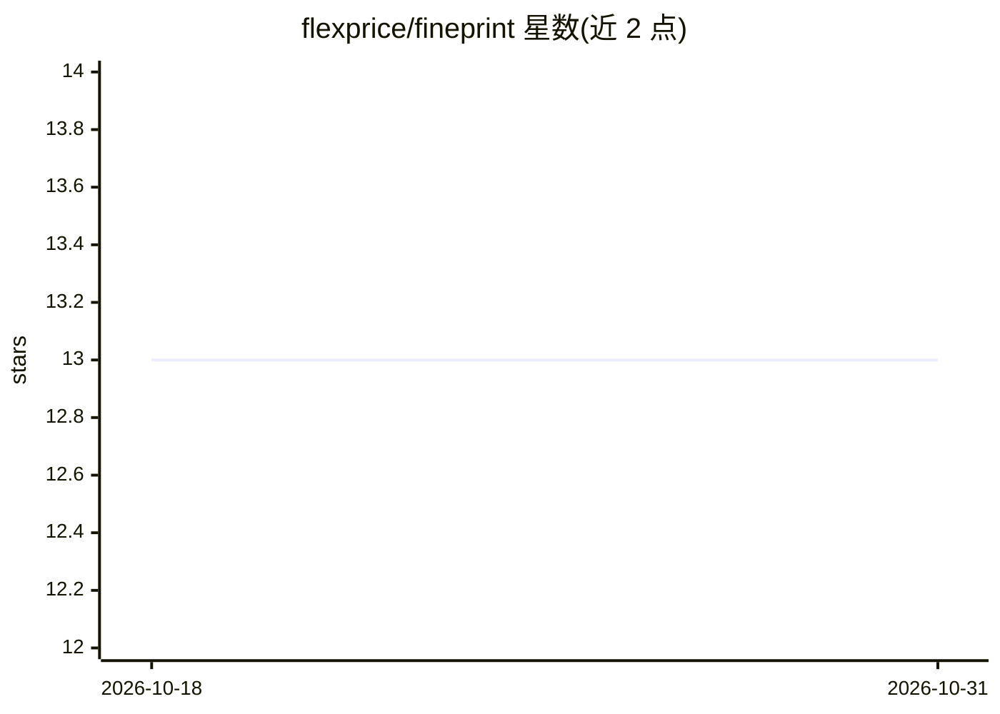

# flexprice/fineprint

⭐ 13 · Python · MIT · 推送 2026-10-30 · [GitHub](https://github.com/flexprice/fineprint) · [官网](fineprint.flexprice.io) · 组织维护

**面向企业的 LLM 合同账单数据抽取基准与排行榜**

Flexprice 维护的文档抽取基准：让各 LLM 从真实合同 PDF 中抽取结构化账单数据（约 18 个硬评分字段：费用、周期、币种、承诺、对手方等），逐字段对照私有 ground truth 评分，输出准确率、幻觉率、成本、延迟与性价比。测试集与标签保持私有以防止刷榜，支持经济等价判定（如 $10k/季度 等价 $40k/年）。提供单命令评测、自动监控新模型的 watch 循环，以及 Next.js 排行榜 Web 应用。用户可通过环境变量接入自有合同数据。

## 筛选速览

| 维度 | 判定 | 备注 |
|---|---|---|
| AI 角色 | `ai-ecosystem` | LLM/agent 周边工具 |
| 许可风险 | `permissive` | MIT |
| 部署形态 | `library` | 以包/库形式分发 |
| 模型依赖 | locked-api |  |
| 硬件要求 | — | 无带数字的原话,不猜 |
| 安装摩擦 | `low` | 无编译、无系统依赖或容器化 |
| 成熟度 | — | 结构信号不足 |

## 能力要点

- 约 18 个硬评分字段，逐字段对照私有 ground truth
- 私有测试集与标签，仅发布匿名化的聚合结果
- 幻觉率单独统计（高置信但错误的比例）
- watch 循环自动检测 OpenRouter 新模型并评测发布（Slack 通知、Vercel 部署）

## 适用场景

- 为企业选型评估各 LLM 抽取合同账单数据的准确性
- 查看质量×成本前沿，权衡模型精度与推理成本
- 用自己的合同与 ground truth 运行评测框架

## 场景标签

`模型评测` · 领域:评测与运维

## 证据(README 行号)

> L7: **The document-extraction benchmark.** Every new LLM, scored on a task real businesses actually run:
> L31: - 🔁 **One command per model.** `python -m fineprint.eval <model>` runs it, scores it, and publishes
> L65: Each `(model × contract × N runs)` call is scored against the private ground truth. We keep the full

## 星数曲线

2026-10-18 13 → 2026-10-31 13（+0）

---
*卡片 v1 · prompt 1.4 · 生成 2026-10-31 · 置信度 high · 依据 README sha `3ec971be4efc` · [字段定义](../../DATASET.md)*
