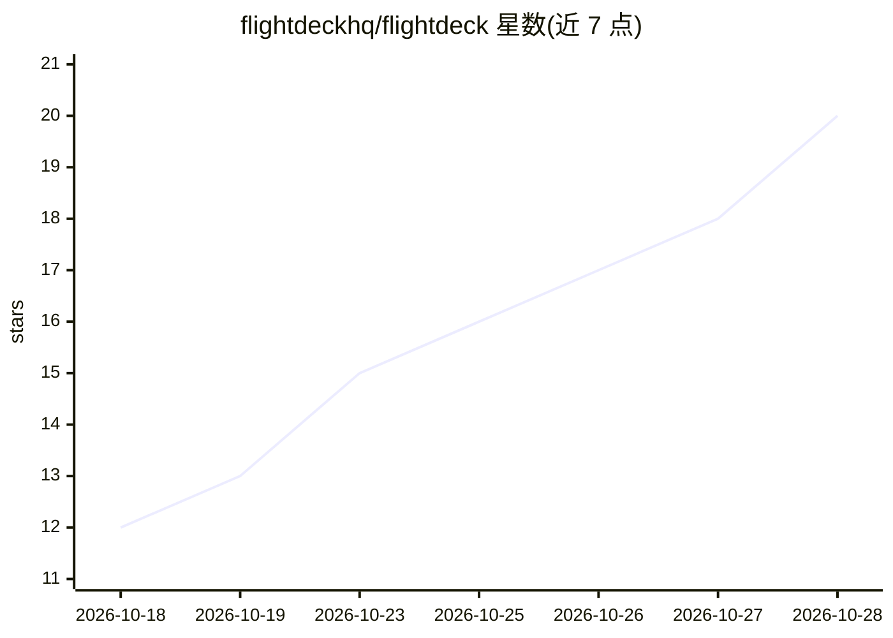

# flightdeckhq/flightdeck

⭐ 22 · TypeScript · Apache-2.0 · 推送 2026-10-28 · [GitHub](https://github.com/flightdeckhq/flightdeck) · [官网](https://flightdeck-hq.com) · 个人维护

**自托管的 AI agent 可观测与控制平面**

面向生产环境与编码 agent 的自托管可观测与控制平面：生产 agent 通过 flightdeck-sensor Python 包以 init()+patch() 接入，编码 agent 通过 Claude Code 插件接入。所有 LLM 调用、MCP 事件与工具调用实时流入仪表盘，提供 fleet 视图、agent 仪表盘、事件搜索与 run 检查。控制面支持 token 预算（警告/降级/阻断三级阈值）、MCP 服务器允许/阻止策略、停止 agent 与自定义指令。限制：Claude Code 插件为 hook 型，无法在调用中执行指令，MCP 覆盖仅限工具调用。

## 筛选速览

| 维度 | 判定 | 备注 |
|---|---|---|
| AI 角色 | `ai-ecosystem` | LLM/agent 周边工具 |
| 许可风险 | `permissive` | Apache-2.0 |
| 部署形态 | `self-host` | docker 或自建部署 |
| 模型依赖 | locked-api |  |
| 硬件要求 | — | 无带数字的原话,不猜 |
| 安装摩擦 | `low` | 无编译、无系统依赖或容器化 |
| 成熟度 | — | 结构信号不足 |

## 能力要点

- 实时 fleet 视图与 per-agent 时间线：LLM 调用、MCP 事件、工具调用、策略事件
- token 预算三级执行：80% 警告、90% 降级换便宜模型、100% 抛 BudgetExceededError
- 传感器拦截 Anthropic/OpenAI/litellm SDK 与 LangChain/LangGraph/LlamaIndex/CrewAI 等框架
- MCP 六类事件观测与 per-flavor 服务器允许/阻止策略

## 适用场景

- 生产环境 agent 的 token 成本、延迟与错误率监控
- 为 agent 设置并集中执行 token 预算与 MCP 服务器白名单
- Claude Code 编码会话纳入 fleet 统一观测
- 多 agent 树状结构与 sub-agent 关系排查

## 场景标签

`LLM 可观测性` · 领域:评测与运维

## 证据(README 行号)

> L3: Flightdeck is a self-hosted observability and control plane for production and coding agents.
> L11: Production agents add the `flightdeck-sensor` Python package to their entrypoint - `init()` + `patch()`, no other c

## 星数曲线

2026-10-18 12 → 2026-10-28 20（+8）

---
*卡片 v1 · prompt 1.4 · 生成 2026-10-28 · 置信度 high · 依据 README sha `7d6e7b96b7cc` · [字段定义](../../DATASET.md)*
