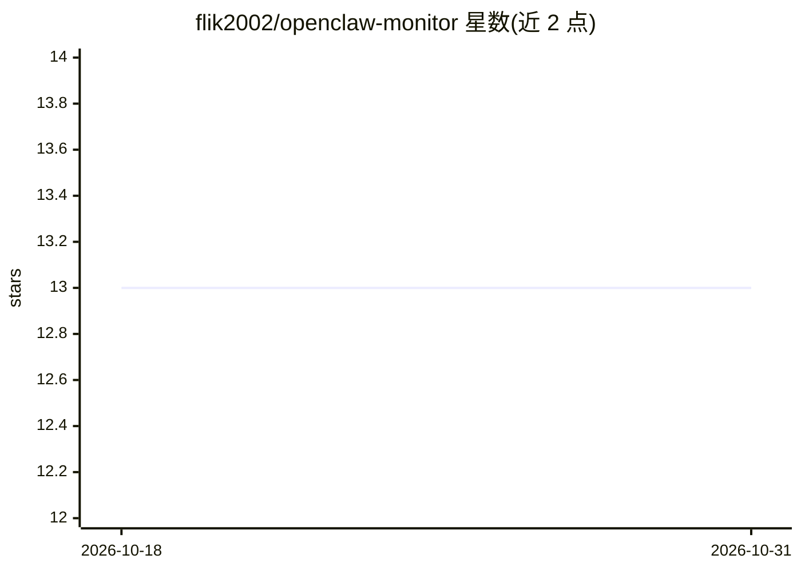

# flik2002/openclaw-monitor

⭐ 13 · JavaScript · MIT · 推送 2026-05-14 · [GitHub](https://github.com/flik2002/openclaw-monitor) · [官网](https://github.com/flik2002/openclaw-monitor) · 个人维护

**OpenClaw AI agent 的开源监控面板：token、会话与趋势**

面向 OpenClaw agent 的免费开源监控仪表盘（MIT）。前端 Vue 3 + Vite + Element Plus + ECharts，后端 Node.js + Express + WebSocket 客户端；数据来自本地会话 JSON 文件，无云端、完全离线。功能包括定时任务可视化、按模型统计 7 天 prompt/completion token 用量条形图、实时会话列表（模型/运行时长/状态）、7 天消息趋势及系统运行时间与内存监控。支持 Claude Code、OpenAI Codex、DeepSeek V4 等多模型展示。需 Node.js 18+ 与运行中的 OpenClaw Gateway（端口 18789）。

## 筛选速览

| 维度 | 判定 | 备注 |
|---|---|---|
| AI 角色 | `ai-ecosystem` | LLM/agent 周边工具 |
| 许可风险 | `permissive` | MIT |
| 部署形态 | `library` | 以包/库形式分发 |
| 模型依赖 | — | README 未给出锁定关系 |
| 硬件要求 | — | 无带数字的原话,不猜 |
| 安装摩擦 | `low` | 无编译、无系统依赖或容器化 |
| 成熟度 | — | 结构信号不足 |

## 能力要点

- 按模型统计 7 天 prompt/completion token 用量
- 实时会话列表与 7 天消息趋势（ECharts）
- 数据本地 JSON 文件，无云端、完全离线
- 系统运行时间与内存监控

## 适用场景

- 查看我的 OpenClaw agent 各模型的 token 消耗
- 实时跟踪 agent 会话运行状态与时长
- 回顾近 7 天消息量趋势

## 场景标签

`LLM 可观测性` · 领域:评测与运维

## 证据(README 行号)

> L3: > AI monitors AI — Free open-source monitoring dashboard for OpenClaw agents.
> L16: - **Token Usage Tracking** — 7-day bar chart of prompt/completion tokens per model

## 星数曲线

2026-10-18 13 → 2026-10-31 13（+0）

---
*卡片 v1 · prompt 1.4 · 生成 2026-10-31 · 置信度 high · 依据 README sha `316930c48e5c` · [字段定义](../../DATASET.md)*
