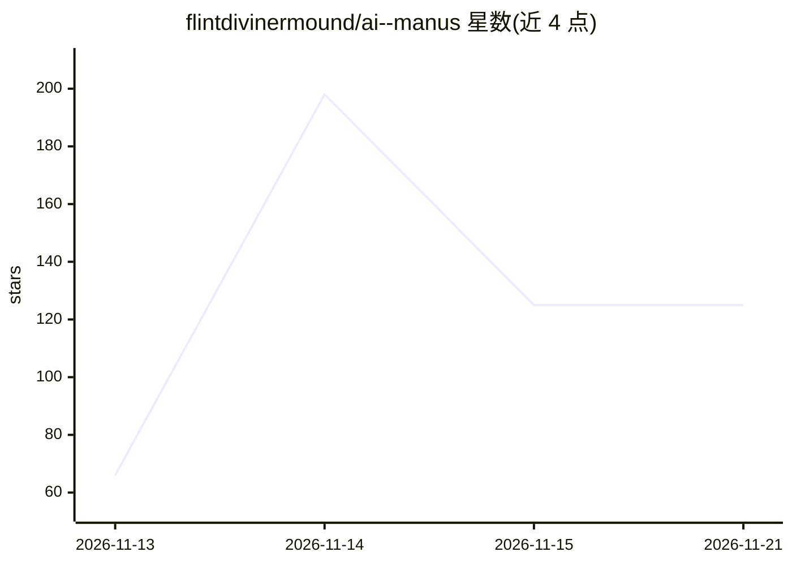

# flintdivinermound/ai--manus

⭐ 125 · Apache-2.0 · 推送 2026-11-15 · [GitHub](https://github.com/flintdivinermound/ai--manus) · 个人维护

**面向日常小任务的自主 AI Agent：自动执行代码与浏览器操作**

Manus 是一个自主运行的 AI agent，代表用户编写并执行脚本、控制浏览器完成多步骤任务，定位为个人助手而非企业平台，覆盖学习、家庭与轻量办公场景。核心机制为代码执行与浏览器控制的组合：任务可在脚本与网页操作间衔接，支持后台待命与跨会话复用工作流模式。README 给出硬件兼容表（最低 4 GB 内存、双核 CPU）与六步上手流程，但未提供具体安装命令、技术栈或代码仓库细节。

## 筛选速览

| 维度 | 判定 | 备注 |
|---|---|---|
| AI 角色 | `ai-native` | 本体是模型或模型工具 |
| 许可风险 | `permissive` | Apache-2.0 |
| 部署形态 | `None` |  |
| 模型依赖 | — | README 未给出锁定关系 |
| 硬件要求 | — | 无带数字的原话,不猜 |
| 安装摩擦 | `low` | 无编译、无系统依赖或容器化 |
| 成熟度 | — | 结构信号不足 |

## 能力要点

- 自主编写并执行代码完成任务
- 浏览器控制：导航网页、填写表单、采集信息
- 代码与浏览器操作在同一任务流中衔接
- 跨会话记忆并复用工作流模式

## 适用场景

- 让学生整理研究笔记并跑快速计算
- 远程工作者从多个网页收集数据
- 把重复性小任务（查页面、填表、跑脚本）交给后台 agent 处理

## 场景标签

`AI 助手` `浏览器自动化` `编码 Agent` · 领域:效率与自动化

## 证据(README 行号)

> L10: - **Autonomous Code Execution:** Manus AI agent runs code on its own to complete tasks, so you can focus on decisio
> L18: Manus is an autonomous AI agent designed to run code and control a browser on your behalf. Instead of acting like a
> L22: Manus is not a heavy studio suite or a complex enterprise platform. It is a focused helper built for home, study, a

## 星数曲线

2026-11-13 66 → 2026-11-21 125（+59）

---
*卡片 v1 · prompt 1.4 · 生成 2026-11-17 · 置信度 low · 依据 README sha `a3d88e202bf0` · [字段定义](../../DATASET.md)*
