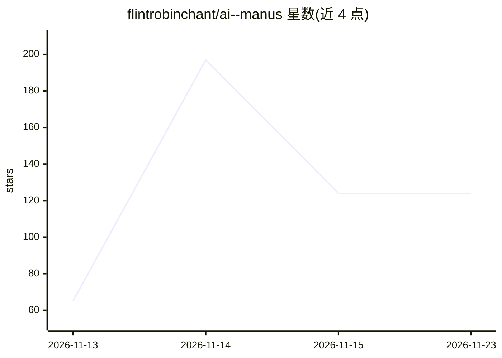

# flintrobinchant/ai--manus

⭐ 124 · Apache-2.0 · 推送 2026-11-15 · [GitHub](https://github.com/flintrobinchant/ai--manus) · 个人维护

**面向个人用户的自主 AI Agent：代为执行代码与浏览器操作**

README 描述的自主 AI 代理系统，定位为个人助手：自行编写并执行脚本、控制浏览器完成多步骤任务（导航网页、填表、收集信息），支持脚本与浏览器动作在同一任务流中衔接，并以后台常驻方式处理研究整理、日常事务等小型任务。目标用户为学生、远程工作者与有多项小项目的个人，明确声明非企业级平台。README 仅含功能描述、兼容性表（最低 4GB 内存/双核 CPU）与使用步骤，未给出任何安装命令、代码入口或技术实现细节（模型、依赖均未说明）。

## 筛选速览

| 维度 | 判定 | 备注 |
|---|---|---|
| AI 角色 | `ai-native` | 本体是模型或模型工具 |
| 许可风险 | `permissive` | Apache-2.0 |
| 部署形态 | `None` |  |
| 模型依赖 | — | README 未给出锁定关系 |
| 硬件要求 | — | 无带数字的原话,不猜 |
| 安装摩擦 | `low` | 无编译、无系统依赖或容器化 |
| 成熟度 | — | 结构信号不足 |

## 能力要点

- 自主编写并执行代码完成任务
- 浏览器控制：导航、填表、信息收集
- 脚本与浏览器动作在同一任务流中衔接
- 支持多步骤任务与后台常驻

## 适用场景

- 让学生整理研究笔记、跑小脚本
- 远程工作者从多个网页收集数据
- 把重复性的小型日常任务委托给后台代理

## 场景标签

`AI 助手` `编码 Agent` `浏览器自动化` `网页抓取` · 领域:效率与自动化

## 证据(README 行号)

> L10: - **Autonomous Code Execution:** Manus AI agent runs code on its own to complete tasks, so you can focus on decisio
> L18: Manus is an autonomous AI agent designed to run code and control a browser on your behalf. Instead of acting like a

## 星数曲线

2026-11-13 65 → 2026-11-23 124（+59）

---
*卡片 v1 · prompt 1.4 · 生成 2026-11-17 · 置信度 low · 依据 README sha `a3d88e202bf0` · [字段定义](../../DATASET.md)*
