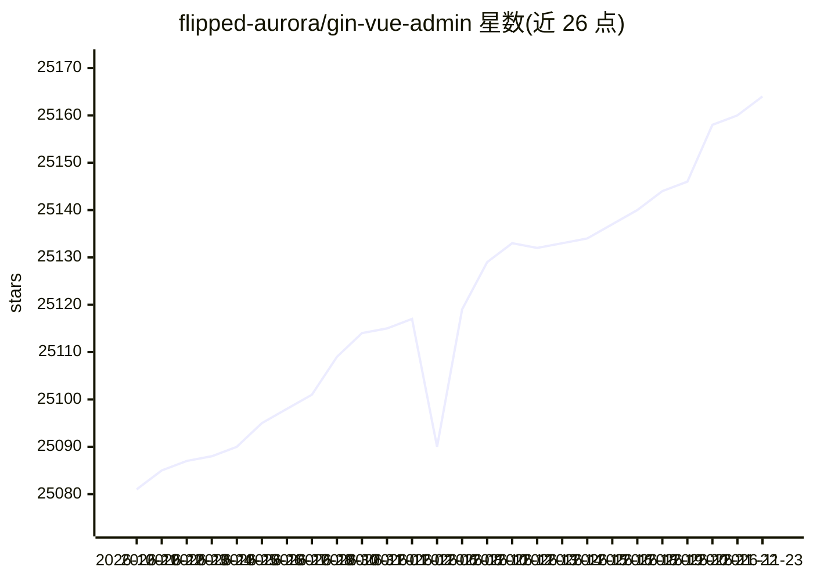

# flipped-aurora/gin-vue-admin

⭐ 25,164 · Go · Apache-2.0 · 推送 2026-11-20 · [GitHub](https://github.com/flipped-aurora/gin-vue-admin) · [官网](http://demo.gin-vue-admin.com/) · 组织维护 · 中文 README

**带 AI 辅助的 Vue+Gin 前后端分离基础开发平台**

基于 vue 和 gin 的全栈前后端分离开发基础平台，内置 JWT 鉴权、casbin 权限管理、动态路由与菜单、表单生成器、代码生成器、分页封装、多点登录拦截、文件上传下载等功能，旨在快速搭建中小型项目。AI 方面提供高度适配 AI 编辑器的 MCP 辅助服务，支持创建基础模板、AI 生成结构、生成代码、分配权限的流程，并内置 skills 管理，支持 TS 和 JS 混用。需要用户具备 golang 和 vue 基础；免费技术服务不提供，另有付费商业授权版。

## 筛选速览

| 维度 | 判定 | 备注 |
|---|---|---|
| AI 角色 | `ai-enhanced` | 去掉 AI 部分产品仍成立 |
| 许可风险 | `permissive` | Apache-2.0 |
| 部署形态 | `library` | 以包/库形式分发 |
| 模型依赖 | — | README 未给出锁定关系 |
| 硬件要求 | — | 无带数字的原话,不猜 |
| 安装摩擦 | `low` | 无编译、无系统依赖或容器化 |
| 成熟度 | — | 结构信号不足 |

## 动量与使用信号

- 维护:`active` — 距上次 push 4.3 天,年发版 7,216 位贡献者
- 涨星:近 1 天 **+6**(自 20261016 起算)
- 下载:GitHub Release 附件 累计 157(78 个 release)

## 能力要点

- 高度适配 AI 编辑器的 MCP 辅助服务与内置 skills 管理
- 基于 jwt 与 casbin 的权限管理及动态路由/菜单
- 代码生成器与表单生成器，快速生成基础 CRUD
- 支持 MySQL/MariaDB、Redis 多点登录限制与七牛云/阿里云/腾讯云上传

## 适用场景

- 快速搭建中小型项目的前后端分离基础平台
- 借助 MCP 在 AI 编辑器中生成基础代码与分配权限
- 需要开箱即用的权限管理、菜单管理与代码生成的后台系统开发

## 场景标签

`代码生成` · 领域:编码与开发

## 证据(README 行号)

> L52: > Gin-vue-admin是一个基于 vue 和 gin 开发的全栈前后端分离的开发基础平台，集成jwt鉴权，动态路由，动态菜单，casbin鉴权，表单生成器，代码生成器等功能，提供多种示例文件，让您把更多时间专注在业务开发上
> L58: Gin-vue-admin 是一套为快速研发准备的一整套前后端分离架构式的开源框架，旨在快速搭建中小型项目。

## 星数曲线

2026-10-21 25,081 → 2026-11-23 25,164（+83）

---
*卡片 v1 · prompt 1.4 · 生成 2026-11-22 · 置信度 high · 依据 README sha `b4eef791096f` · [字段定义](../../DATASET.md)*
