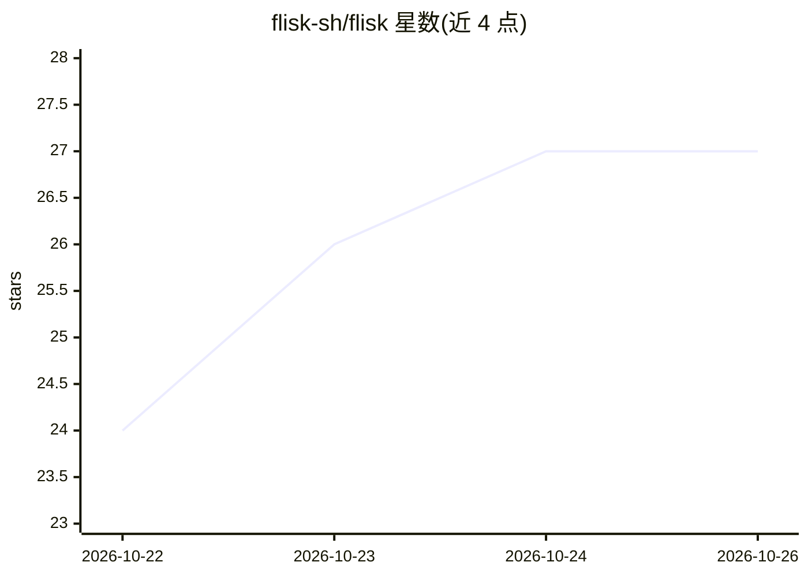

# flisk-sh/flisk

⭐ 27 · TypeScript · MIT · 推送 2026-10-25 · [GitHub](https://github.com/flisk-sh/flisk) · [官网](https://flisk.sh) · 组织维护

**本地全栈开发运行时：一条命令生成并运行容器化技术栈**

面向开发者的本地开发运行时 CLI：通过每服务一个 service.json 声明，自动生成 Dockerfile、Traefik 路由与 Tiltfile，由 Docker 运行容器、Tilt 热更新，无需本地 Kubernetes 或手写 docker-compose。支持 AI 编码代理（Claude Code/Codex/Cursor 等）经提示词或 MCP 调用其命令，可脚手架生成 agent、MCP 工具服务与数据库并纳入同一栈运行。核心 CLI 为 MIT，Premium 为可选项；不做生产部署。需 Docker、Tilt、Node.js 22.12+、Bun 1.2+。

## 筛选速览

| 维度 | 判定 | 备注 |
|---|---|---|
| AI 角色 | `ai-ecosystem` | LLM/agent 周边工具 |
| 许可风险 | `permissive` | MIT |
| 部署形态 | `self-host` | docker 或自建部署 |
| 模型依赖 | — | README 未给出锁定关系 |
| 硬件要求 | — | 无带数字的原话,不猜 |
| 安装摩擦 | `low` | 无编译、无系统依赖或容器化 |
| 成熟度 | — | 结构信号不足 |

## 能力要点

- service.json 声明式生成 Dockerfile/Traefik 路由/Tiltfile 并做漂移检查
- AI 代理可通过 MCP 或命令直接搭建与操作栈（flisk up/doctor/status 等）
- 一条命令脚手架 agent + MCP 工具服务 + 数据库同栈运行，含会话粘性路由与检查点卷
- 支持 Bun/Node/Python/Go/Rust/React 等运行时与框架

## 适用场景

- 让 AI 编码代理替我搭建并运行一个本地全栈应用
- 不用手写 compose/K8s 就能在本地跑起多服务加数据库的栈
- 把 AI agent、MCP 工具服务和数据库放进同一个本地栈里运行

## 场景标签

`代码生成` · 领域:编码与开发

## 证据(README 行号)

> L183: Flisk is the local runtime for agent *systems*: the agent, its MCP tools, its database, its queue, behind one gate
> L194: **What Flisk is:** a local development runtime. Define each service in `service.json` and run `flisk up`. Docker r

## 星数曲线

2026-10-22 24 → 2026-10-26 27（+3）

---
*卡片 v1 · prompt 1.4 · 生成 2026-10-26 · 置信度 mid · 依据 README sha `8bff11aacba1` · [字段定义](../../DATASET.md)*
