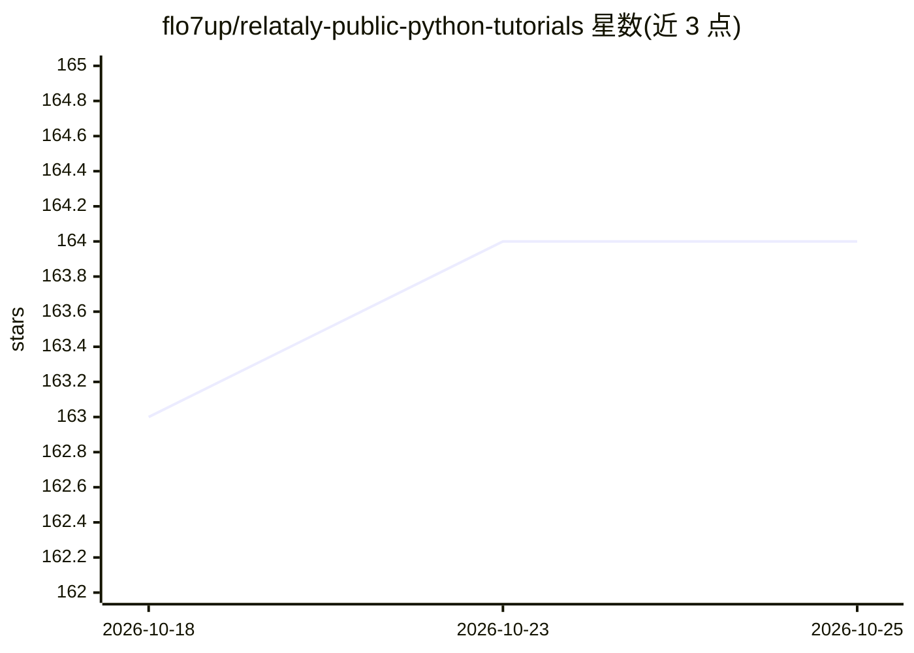

# flo7up/relataly-public-python-tutorials

⭐ 164 · Jupyter Notebook · CC-BY-SA-4.0 · 推送 2026-08-24 · [GitHub](https://github.com/flo7up/relataly-public-python-tutorials) · [官网](https://www.relataly.com) · 组织维护

**机器学习/深度学习/生成式 AI 的实战 Python notebook 教程集**

Relataly.com 技术文章配套的 Jupyter notebook 集合，覆盖应用机器学习（异常检测、特征选择、流失预测）、深度学习、时间序列预测、生成式 AI（OpenAI/DALL-E 示例）、推荐系统与 PySpark 分布式分析等约 60+ 编号教程。每篇 notebook 对应网站上的一篇文章，用户在本地或托管 notebook 环境中自行安装依赖运行。README 明确说明内容随时间发布，可能反映发布时的 API 与库版本，生产使用前需自行验证依赖与输出。采用 CC BY-SA 4.0 许可。

## 筛选速览

| 维度 | 判定 | 备注 |
|---|---|---|
| AI 角色 | `ai-knowledge` | 知识聚合/清单类 |
| 许可风险 | `viral` | CC-BY-SA-4.0 |
| 部署形态 | `None` |  |
| 模型依赖 | — | README 未给出锁定关系 |
| 硬件要求 | — | 无带数字的原话,不猜 |
| 安装摩擦 | `low` | 无编译、无系统依赖或容器化 |
| 成熟度 | — | 结构信号不足 |

## 能力要点

- 约 60+ 编号教程覆盖 ML/DL/时间序列/生成式 AI/推荐系统
- OpenAI 专区含 DALL-E 提示增强、向量/混合检索等 5 篇示例
- 教程与 Relataly.com 技术文章一一对应
- 含 Fairlearn 公平机器学习专题

## 适用场景

- 按编号查找某个具体 ML 任务的参考实现
- 学习时间序列预测或推荐系统的实践代码
- 了解 OpenAI API 在分类、检索、对话等任务中的用法

## 场景标签

`教程课程` · 领域:学习与行业

## 证据(README 行号)

> L3: A collection of practical Jupyter notebooks for applied machine learning, deep learning, generative AI, and analytic
> L9: |Area|Examples|
> L98: - Browse the repository for individual `.ipynb` projects.

## 星数曲线

2026-10-18 163 → 2026-10-25 164（+1）

---
*卡片 v1 · prompt 1.4 · 生成 2026-10-22 · 置信度 high · 依据 README sha `5b4596c3f448` · [字段定义](../../DATASET.md)*
