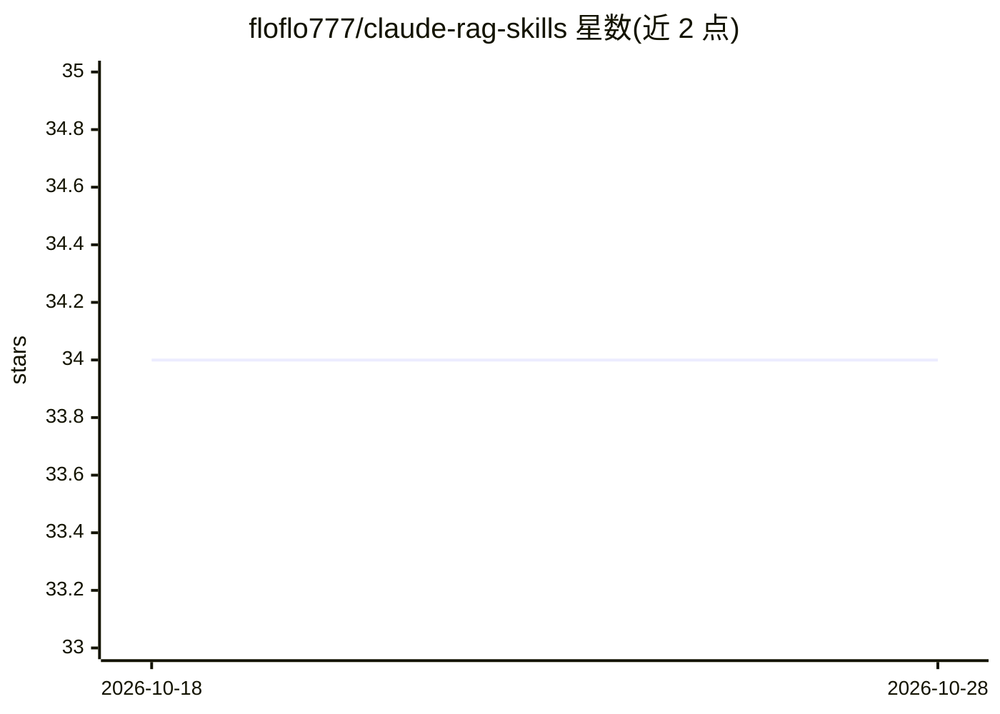

# floflo777/claude-rag-skills

⭐ 34 · MIT · 推送 2026-01-18 · [GitHub](https://github.com/floflo777/claude-rag-skills) · 个人维护

**给 Claude Code 的 RAG 开发技能包：审计、评测、切块建议与脚手架**

面向 Claude Code 的四个技能（skill）集合，通过斜杠命令调用：/rag-audit 扫描代码库识别 RAG 反模式（切块、嵌入、检索、生成、生产化五类问题）；/rag-eval 用 Recall@K、MRR、NDCG、Faithfulness 等指标评测 RAG 系统；/chunking-advisor 按文档类型与查询模式给出切块策略建议；/rag-scaffold 生成五种框架组合（LangChain+Qdrant、LlamaIndex、Vanilla、LangChain.js、Ailog API）的生产级 RAG 模板。可选接入 Ailog API 做基准对比；要求 Claude Code >= 2.0.0，MIT 许可。

## 筛选速览

| 维度 | 判定 | 备注 |
|---|---|---|
| AI 角色 | `ai-ecosystem` | LLM/agent 周边工具 |
| 许可风险 | `permissive` | MIT |
| 部署形态 | `None` |  |
| 模型依赖 | locked-api |  |
| 硬件要求 | — | 无带数字的原话,不猜 |
| 安装摩擦 | `low` | 无编译、无系统依赖或容器化 |
| 成熟度 | — | 结构信号不足 |

## 能力要点

- 代码库级 RAG 反模式审计（切块/嵌入/检索/生成/生产化五类）
- 标准检索与生成指标评测（Recall@K、MRR、NDCG、Faithfulness）
- 生成五种框架组合的生产级 RAG 脚手架（含 Docker 与测试）
- 可选对接 Ailog API 做 RAG 基准对比

## 适用场景

- 在 Claude Code 会话中审计现有 RAG 代码的反模式
- 为 RAG 系统选型切块策略并生成项目脚手架
- 用标准指标评测自有 RAG 系统的质量

## 场景标签

`RAG` `模型评测` `代码生成` · 领域:编码与开发

## 证据(README 行号)

> L3: Professional skills for building, auditing, evaluating, and optimizing RAG (Retrieval-Augmented Generation) systems 
> L14: |**RAG Audit**|`/rag-audit`|Analyze existing RAG code for anti-patterns and issues|
> L109: Generate complete, production-ready RAG pipelines:

## 星数曲线

2026-10-18 34 → 2026-10-28 34（+0）

---
*卡片 v1 · prompt 1.4 · 生成 2026-10-25 · 置信度 high · 依据 README sha `56d1a7e1e220` · [字段定义](../../DATASET.md)*
