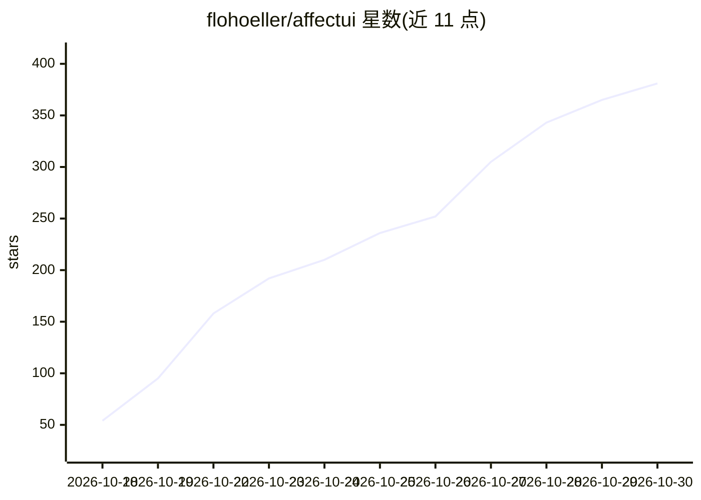

# flohoeller/affectui

⭐ 381 · TypeScript · MIT · 推送 2026-10-29 · [GitHub](https://github.com/flohoeller/affectui) · [官网](https://www.affectui.com) · 个人维护

**面向 AI 产品的 React 组件/插画/动效库**

MIT 许可的 React 组件、插画与动效库，面向 AI 产品与现代 SaaS 应用，含 57 个免费条目（按钮、消息操作栏、思考加载器、命令菜单等）。每个条目是单个 .tsx 文件、样式内含，无需 Tailwind、CSS 配置或动画库；支持暗色模式、prefers-reduced-motion、键盘与无障碍。通过 shadcn CLI 安装或直接复制源码，另提供 MCP server 供 Claude Code、Cursor 等工具检索与安装条目。要求 React 19。标 Pro 的条目不在本仓库内。

## 筛选速览

| 维度 | 判定 | 备注 |
|---|---|---|
| AI 角色 | `ai-ecosystem` | LLM/agent 周边工具 |
| 许可风险 | `permissive` | MIT |
| 部署形态 | `library` | 以包/库形式分发 |
| 模型依赖 | — | README 未给出锁定关系 |
| 硬件要求 | — | 无带数字的原话,不猜 |
| 安装摩擦 | `low` | 无编译、无系统依赖或容器化 |
| 成熟度 | — | 结构信号不足 |

## 能力要点

- 每个条目为单个 .tsx 文件，样式内含，无 Tailwind/CSS 框架依赖
- 内置暗色模式、prefers-reduced-motion 与键盘无障碍支持
- 经 shadcn CLI 或复制文件安装，源码归用户所有
- 提供 MCP server 供 AI 编码工具检索、读取文档并安装条目

## 适用场景

- 为 AI 聊天产品搭建消息操作栏、思考加载器等界面
- 为 SaaS 产品快速接入暗色模式与动效组件
- 通过 AI 编码工具（Cursor/Claude Code 等）自动检索并安装组件

## 场景标签

 · 领域:前端/UI 组件

## 证据(README 行号)

> L23: affectUI is a library of handcrafted React components, illustrations and motion effects for AI products and modern 
> L144: affectUI is agent-ready. Connect the **MCP server** once and Claude Code, Cursor, VS Code or Codex can search ever

## 星数曲线

2026-10-18 54 → 2026-10-30 381（+327）

---
*卡片 v1 · prompt 1.4 · 生成 2026-10-22 · 置信度 high · 依据 README sha `2a554fbccc2c` · [字段定义](../../DATASET.md)*
