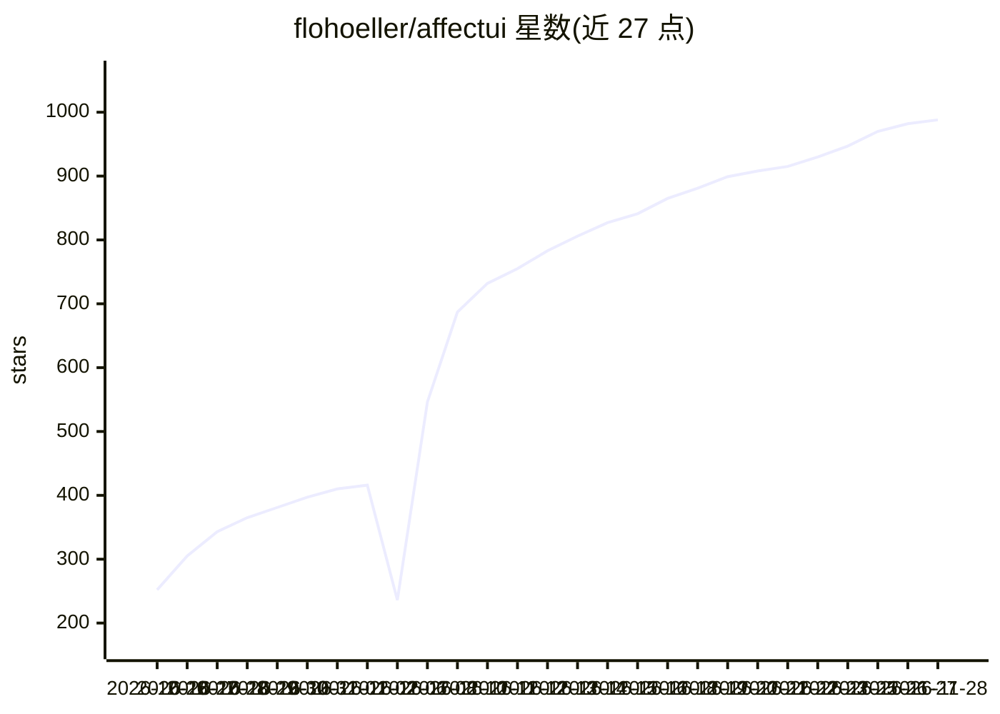

# flohoeller/affectui

⭐ 988 · TypeScript · MIT · 推送 2026-11-27 · [GitHub](https://github.com/flohoeller/affectui) · [官网](https://www.affectui.com) · 组织维护

**为 AI agent 应用提供的 React 组件库：呈现运行、工具调用与审批**

affectUI 是一组 React 组件库，覆盖 agent 运行树、工具调用卡片、trace 时间线、handoff、审批收件箱等 agent 界面，同时包含按钮、表单、图表等通用 UI 组件。每个组件为单个 .tsx 文件、样式内联，不依赖 Tailwind 或动画库。通过 shadcn CLI 安装，或经 MCP 服务器由 Claude Code/Cursor/Codex 等编码助手检索添加。MIT 许可，仓库免费条目 75 个，另有 Pro 付费条目不在此仓库中。需要 React 19。

## 筛选速览

| 维度 | 判定 | 备注 |
|---|---|---|
| AI 角色 | `ai-ecosystem` | LLM/agent 周边工具 |
| 许可风险 | `permissive` | MIT |
| 部署形态 | `library` | 以包/库形式分发 |
| 模型依赖 | — | README 未给出锁定关系 |
| 硬件要求 | — | 无带数字的原话,不猜 |
| 安装摩擦 | `low` | 无编译、无系统依赖或容器化 |
| 成熟度 | — | 结构信号不足 |

## 能力要点

- 每个组件为单个 .tsx 文件，样式内联，无需 CSS 框架配置
- 提供 MCP 服务器与 llms.txt，供编码助手搜索并安装组件
- 覆盖 agent tree、tool call、trace waterfall、decision inbox、handoff 等 agent UI 场景
- 内置暗色模式、无障碍支持与容器查询响应式

## 适用场景

- 为 agent 应用构建运行进度、任务计划与结果展示界面
- 实现人工审批环节，让用户在执行前审核 agent 提议的操作
- 展示 LLM 调用、工具调用的耗时与成本 trace
- 通过 MCP 让编码助手自动查找并添加组件

## 场景标签

 · 领域:前端组件库/AI 应用开发

## 证据(README 行号)

> L23: **UI for AI agents.** affectUI is a library of React components for what agents do – runs, tool calls, traces, hand
> L91: - **Made for agents.** Components for what agents actually do: trees of sub-agents, tool calls, traces with cost pe

## 星数曲线

2026-10-26 252 → 2026-11-28 988（+736）

---
*卡片 v1 · prompt 1.4 · 生成 2026-11-27 · 置信度 mid · 依据 README sha `cc3aaaf8da9f` · [字段定义](../../DATASET.md)*
