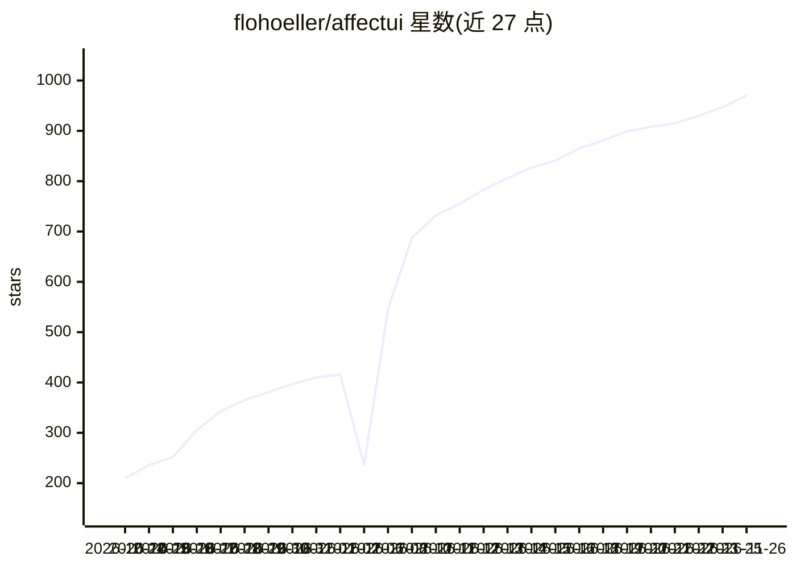

# flohoeller/affectui

⭐ 970 · TypeScript · MIT · 推送 2026-11-25 · [GitHub](https://github.com/flohoeller/affectui) · [官网](https://www.affectui.com) · 组织维护

**给开发者的 AI agent 界面 React 组件库**

面向构建 AI agent 产品的前端开发者提供的 React 组件库，覆盖 agent 运行、工具调用、链路追踪、handoff、审批等界面，也含按钮、表单等通用组件。每个组件是单个 .tsx 文件、样式内嵌，无需 Tailwind 或 CSS 配置；通过 shadcn CLI 安装，或经 MCP 服务器让 Claude Code、Cursor、Codex 检索添加。免费项 74 个，部分组件属 Pro 不在本仓库；要求 React 19，MIT 许可。

## 筛选速览

| 维度 | 判定 | 备注 |
|---|---|---|
| AI 角色 | `ai-ecosystem` | LLM/agent 周边工具 |
| 许可风险 | `permissive` | MIT |
| 部署形态 | `library` | 以包/库形式分发 |
| 模型依赖 | — | README 未给出锁定关系 |
| 硬件要求 | — | 无带数字的原话,不猜 |
| 安装摩擦 | `low` | 无编译、无系统依赖或容器化 |
| 成熟度 | — | 结构信号不足 |

## 能力要点

- Agent 专用组件：agent 树、工具调用卡片、trace 时间线（含每步 token 与成本）、handoff、审批
- 每个组件为单一 .tsx 文件，样式内嵌，无需 Tailwind/CSS/动画库配置
- 提供 MCP 服务器与 llms.txt，供 Claude Code、Cursor、Codex、v0 自动发现并安装组件
- 内置暗色模式、无障碍支持与 prefers-reduced-motion 适配

## 适用场景

- 为 agent 产品搭建运行进度、任务计划与审批界面
- 在 agent UI 中展示工具调用结果与失败信息
- 用 MCP 让编程助手在项目中自动添加组件

## 场景标签

`Agent 框架` · 领域:Agent 开发

## 证据(README 行号)

> L23: **UI for AI agents.** affectUI is a library of React components for what agents do – runs, tool calls, traces, hand
> L101: affectUI is the presentation layer of an AI product. Your application supplies runtime data, connects tools and en

## 星数曲线

2026-10-24 210 → 2026-11-26 970（+760）

---
*卡片 v1 · prompt 1.4 · 生成 2026-11-25 · 置信度 high · 依据 README sha `d4a03272bf93` · [字段定义](../../DATASET.md)*
