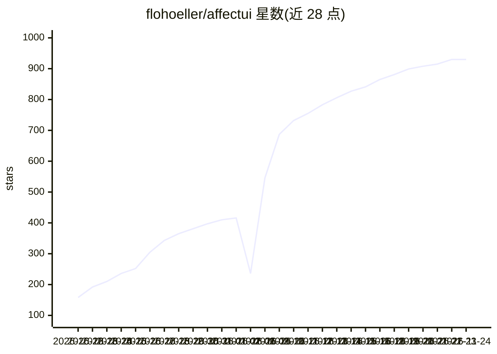

# flohoeller/affectui

⭐ 930 · TypeScript · MIT · 推送 2026-11-22 · [GitHub](https://github.com/flohoeller/affectui) · [官网](https://www.affectui.com) · 组织维护

**面向 agent 应用的 React UI 组件库：agent 树、工具调用、审批界面**

affectUI 提供 74 个免费 React 组件，覆盖 agent 运行、工具调用、trace、handoff、审批等界面，也包含按钮、表单、图表等常规 UI 组件。每个组件是单个 .tsx 文件、样式内嵌，不依赖 Tailwind 或动画库；通过 shadcn CLI 添加，或经 MCP 服务器由 Claude Code、Cursor、Codex 等编码助手检索并安装。组件为源码形式归使用者所有。部分标记 Pro 的组件不在本仓库内。要求 React 19。

## 筛选速览

| 维度 | 判定 | 备注 |
|---|---|---|
| AI 角色 | `ai-ecosystem` | LLM/agent 周边工具 |
| 许可风险 | `permissive` | MIT |
| 部署形态 | `library` | 以包/库形式分发 |
| 模型依赖 | — | README 未给出锁定关系 |
| 硬件要求 | — | 无带数字的原话,不猜 |
| 安装摩擦 | `low` | 无编译、无系统依赖或容器化 |
| 成熟度 | — | 结构信号不足 |

## 能力要点

- agent 专用组件：Agent Tree、Tool Call Card、Trace Waterfall、Agent Inbox、Context Map 等
- 每个组件为单个 .tsx 文件，无 Tailwind、无 CSS 配置、无动画库依赖
- 提供 MCP 服务器与 llms.txt，供编码助手检索和安装组件
- 内置暗色模式、prefers-reduced-motion 支持与容器查询响应式

## 适用场景

- 为 agent 应用搭建运行进度、决策审批的界面
- 在 human-in-the-loop 流程中呈现待审批的操作与目标
- 展示 agent 运行的耗时、token 与成本分布
- 用编码助手通过 MCP 直接添加组件到项目

## 场景标签

 · 领域:前端组件库/AI 应用开发

## 证据(README 行号)

> L23: **UI for AI agents.** affectUI is a library of React components for what agents do – runs, tool calls, traces, hand
> L101: affectUI is the presentation layer of an AI product. Your application supplies runtime data, connects tools and en
> L161: affectUI is agent-ready. Connect the **MCP server** once and Claude Code, Cursor, VS Code or Codex can search ever

## 星数曲线

2026-10-22 158 → 2026-11-24 930（+772）

---
*卡片 v1 · prompt 1.4 · 生成 2026-11-24 · 置信度 high · 依据 README sha `a6ac9ed5ba6b` · [字段定义](../../DATASET.md)*
