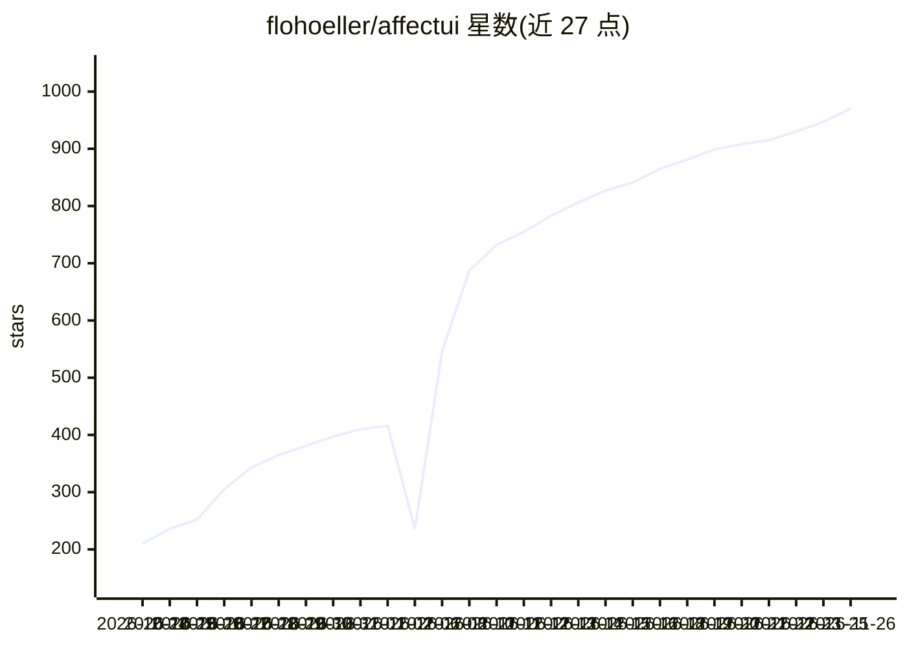

# flohoeller/affectui

⭐ 970 · TypeScript · MIT · 推送 2026-11-25 · [GitHub](https://github.com/flohoeller/affectui) · [官网](https://www.affectui.com) · 组织维护

**面向 AI agent 的 React UI 组件库：agent 树、工具调用与审批界面**

affectUI 提供 75 个免费 React 组件，覆盖 agent 运行树、工具调用卡片、trace 时间线、handoff、审批与上下文窗口等 agent 场景，也包含按钮、表单等常规 UI 件。每个组件是单个内含样式的 .tsx 文件，不依赖 Tailwind 或动画库；通过 shadcn CLI 安装，或经 MCP server 供 Claude Code、Cursor、Codex 添加。要求 React 19；标记 Pro 的组件不在本仓库内。MIT 许可。

## 筛选速览

| 维度 | 判定 | 备注 |
|---|---|---|
| AI 角色 | `ai-ecosystem` | LLM/agent 周边工具 |
| 许可风险 | `permissive` | MIT |
| 部署形态 | `library` | 以包/库形式分发 |
| 模型依赖 | — | README 未给出锁定关系 |
| 硬件要求 | — | 无带数字的原话,不猜 |
| 安装摩擦 | `low` | 无编译、无系统依赖或容器化 |
| 成熟度 | — | 结构信号不足 |

## 能力要点

- agent 场景组件：Agent Tree、Tool Call Card、Trace Waterfall、Agent Handoff 等
- 每个组件为单个 .tsx 文件，无需 Tailwind/CSS/动画库配置
- 提供 MCP server 与 llms.txt 供编程助手检索并安装组件
- 内置暗色模式、无障碍支持与 prefers-reduced-motion 适配

## 适用场景

- 为 agent 应用搭建运行进度、任务树与成本展示界面
- 实现人在环路的动作审批与决策收件箱
- 展示 agent 的 LLM 调用与工具调用时间线、token 与成本
- 通过 MCP 让编程助手自动添加组件到项目

## 场景标签

 · 领域:前端开发/Agent 工具链

## 证据(README 行号)

> L23: **UI for AI agents.** affectUI is a library of React components for what agents do – runs, tool calls, traces, hand
> L91: - **Made for agents.** Components for what agents actually do: trees of sub-agents, tool calls, traces with cost pe

## 星数曲线

2026-10-24 210 → 2026-11-26 970（+760）

---
*卡片 v1 · prompt 1.4 · 生成 2026-11-26 · 置信度 high · 依据 README sha `eb5b2c55c9f8` · [字段定义](../../DATASET.md)*
