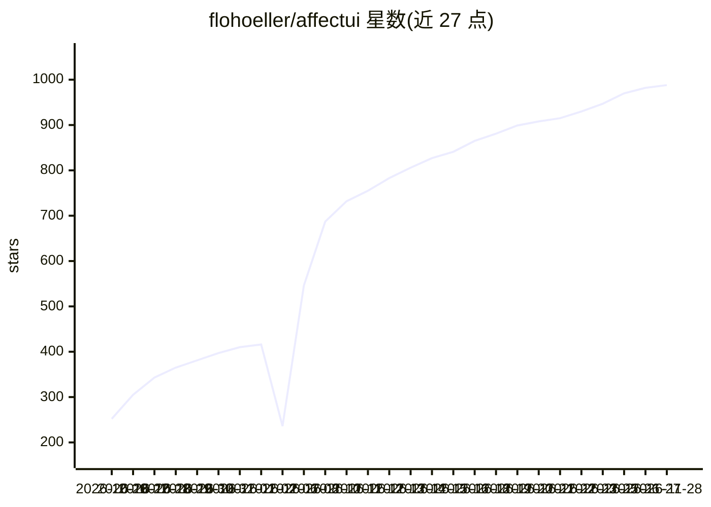

# flohoeller/affectui

⭐ 988 · TypeScript · MIT · 推送 2026-11-27 · [GitHub](https://github.com/flohoeller/affectui) · [官网](https://www.affectui.com) · 个人维护

**为开发者提供 AI agent 运行状态展示的 React 组件库**

affectUI 是一组 React 组件库，用于渲染 agent 的运行、工具调用、追踪、交接、审批与上下文窗口等状态，同时提供输入框、菜单、图表等通用 UI 组件。每个组件为单个 .tsx 文件、样式内联，无 Tailwind 与动画库依赖；通过 shadcn CLI 安装，或经 MCP 服务器由 Claude Code、Cursor、Codex 自动添加。React 19 环境运行。仓库内组件免费，部分标 Pro 的组件不在本仓库内。

## 筛选速览

| 维度 | 判定 | 备注 |
|---|---|---|
| AI 角色 | `ai-ecosystem` | LLM/agent 周边工具 |
| 许可风险 | `permissive` | MIT |
| 部署形态 | `library` | 以包/库形式分发 |
| 模型依赖 | — | README 未给出锁定关系 |
| 硬件要求 | — | 无带数字的原话,不猜 |
| 安装摩擦 | `low` | 无编译、无系统依赖或容器化 |
| 成熟度 | — | 结构信号不足 |

## 能力要点

- 每个组件为单个 .tsx 文件，样式内联，无需 CSS 框架
- 提供 MCP 服务器与 llms.txt，支持 AI 编码工具搜索并安装组件
- 内置暗色模式、容器查询响应式与 prefers-reduced-motion 支持
- 组件覆盖 agent 树、工具调用卡片、追踪瀑布图、审批收件箱等

## 适用场景

- 为 agent 应用搭建任务进度、运行追踪与审批界面
- 在 React 应用中展示 LLM 调用与工具调用的耗时和成本
- 通过 AI 编码助手自动查找并安装 UI 组件

## 场景标签

 · 领域:前端开发/AI 应用基础设施

## 证据(README 行号)

> L23: **UI for AI agents.** affectUI is a library of React components for what agents do – runs, tool calls, traces, hand
> L92: - **Agent-ready.** An MCP server and `llms.txt` let Claude Code, Cursor, Codex or v0 find and add items for you.
> L101: affectUI is the presentation layer of an AI product. Your application supplies runtime data, connects tools and en

## 星数曲线

2026-10-26 252 → 2026-11-28 988（+736）

---
*卡片 v1 · prompt 1.4 · 生成 2026-11-28 · 置信度 high · 依据 README sha `4ed4fd6bc4a1` · [字段定义](../../DATASET.md)*
