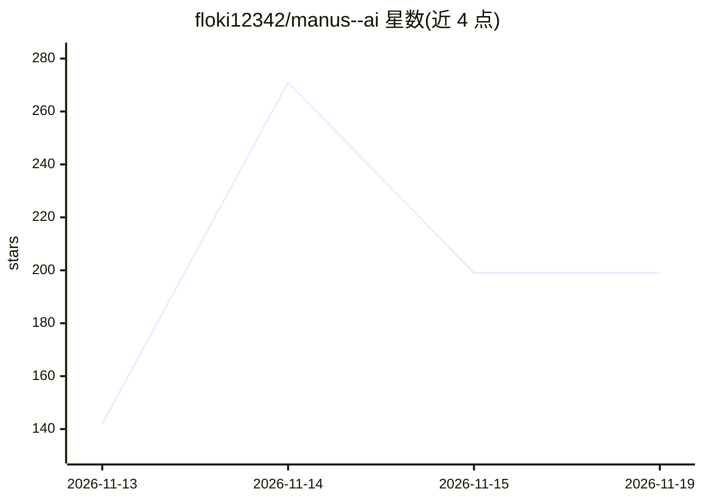

# floki12342/manus--ai

⭐ 199 · Apache-2.0 · 推送 2026-11-15 · [GitHub](https://github.com/floki12342/manus--ai) · 个人维护

**面向个人用户的自主 AI Agent：代跑代码与操控浏览器**

自述为自主运行的 AI agent，可在用户授权下编写并执行脚本、控制浏览器完成页面浏览、表单填写与多步任务，定位是家庭、学习与轻量办公场景的个人助手，而非企业平台。README 提供系统兼容性表（最低双核 CPU、4 GB 内存）与使用步骤说明（准备、配置、测试、逐步扩大自动化范围），并声明需标准用户权限、推荐提升权限以获得完整浏览器控制。未给出安装命令、依赖说明或代码入口，'Download Manus / PROMO2026' 仅为一行下载提示，无具体渠道。

## 筛选速览

| 维度 | 判定 | 备注 |
|---|---|---|
| AI 角色 | `ai-native` | 本体是模型或模型工具 |
| 许可风险 | `permissive` | Apache-2.0 |
| 部署形态 | `None` |  |
| 模型依赖 | — | README 未给出锁定关系 |
| 硬件要求 | — | 无带数字的原话,不猜 |
| 安装摩擦 | `low` | 无编译、无系统依赖或容器化 |
| 成熟度 | — | 结构信号不足 |

## 能力要点

- 自主执行代码与浏览器操作的多步任务
- 面向非开发者用户，覆盖学习、家庭与轻量办公场景
- README 给出最低/推荐硬件配置表与六步上手流程

## 适用场景

- 让 agent 代为执行重复性的脚本与网页操作
- 研究资料收集、表单填写等日常任务委托
- 小项目开发中的快速实验与结果比对

## 场景标签

`AI 助手` `编码 Agent` `浏览器自动化` · 领域:效率与自动化

## 证据(README 行号)

> L10: - **Autonomous Code Execution:** Manus AI agent runs code on its own to complete tasks, so you can focus on decisio
> L18: Manus is an autonomous AI agent designed to run code and control a browser on your behalf. Instead of acting like a

## 星数曲线

2026-11-13 142 → 2026-11-19 199（+57）

---
*卡片 v1 · prompt 1.4 · 生成 2026-11-17 · 置信度 mid · 依据 README sha `25103b48adc2` · [字段定义](../../DATASET.md)*
