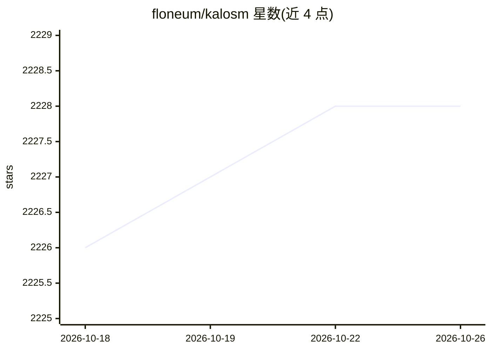

# floneum/kalosm

⭐ 2,228 · Rust · Apache-2.0 · 推送 2026-10-24 · [GitHub](https://github.com/floneum/kalosm) · [官网](http://floneum.com/kalosm) · 个人维护

**Rust 本地/远程预训练模型接口与推理运行时生态**

Kalosm 是一个 Rust crate 集合，为开发者提供访问本地或远程预训练模型的统一接口，支持 Llama、Mistral、Phi、Whisper、Segment Anything、Bert 等文本/音频/图像模型的量化与 GPU 加速推理。附带 RAG 上下文提取与检索、音频转录、网页抓取等工具库，并支持基于任意 Rust 类型与自定义语法的结构化生成。仓库内另含 Fusor：编译器驱动的 CPU/WebGPU 量化推理运行时（读取 GGUF 模型，e-graph 算子融合），自述尚处早期、不适合生产使用。

## 筛选速览

| 维度 | 判定 | 备注 |
|---|---|---|
| AI 角色 | `ai-ecosystem` | LLM/agent 周边工具 |
| 许可风险 | `permissive` | Apache-2.0 |
| 部署形态 | `library` | 以包/库形式分发 |
| 模型依赖 | — | README 未给出锁定关系 |
| 硬件要求 | — | 无带数字的原话,不猜 |
| 安装摩擦 | `low` | 无编译、无系统依赖或容器化 |
| 成熟度 | `idea` | |

## 能力要点

- 支持 Llama/Mistral/Phi/Whisper/Segment Anything/Bert 等多模态模型，含量化与 GPU 加速
- 基于 Rust 类型 derive 与自定义语法的结构化生成（含结构感知加速）
- RAG 工具链：txt/html/docx/md/pdf 上下文提取、分块与向量数据库检索
- Fusor：e-graph 编译的 CPU/WebGPU 量化推理运行时，加载 GGUF 模型

## 适用场景

- 在 Rust 应用中集成本地 LLM 聊天或转录功能
- 用结构化生成约束模型输出为 JSON/XML 等格式
- 搭建带文档检索的本地 RAG 应用

## 场景标签

`RAG` `语音识别` `推理引擎` · 领域:知识与检索

## 证据(README 行号)

> L22: Kalosm is an ecosystem of crates that make it easy to develop applications that use local or remote AI models. Ther
> L29: Kalosm is a simple interface for pre-trained models in Rust. It makes it easy to interact with pre-trained, languag

## 星数曲线

2026-10-18 2,226 → 2026-10-26 2,228（+2）

---
*卡片 v1 · prompt 1.4 · 生成 2026-10-21 · 置信度 high · 依据 README sha `68980ec9febd` · [字段定义](../../DATASET.md)*
