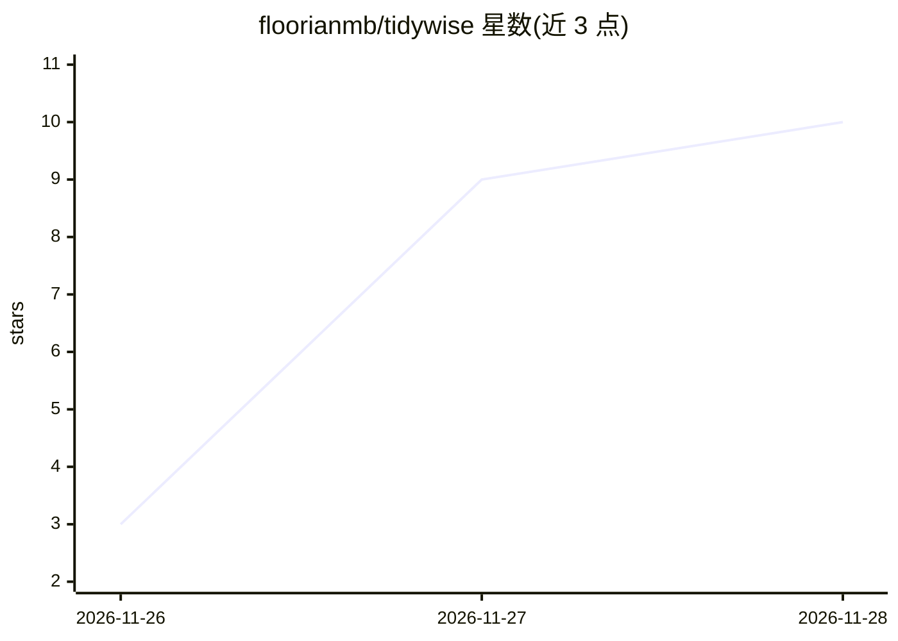

# floorianmb/tidywise

⭐ 10 · Swift · MIT · 推送 2026-11-27 · [GitHub](https://github.com/floorianmb/tidywise) · 个人维护 · 中文 README

**macOS 用户：用本地模型把散落文件自动归类到主题文件夹**

一款 macOS 菜单栏应用：扫描 Downloads、Documents、Desktop 中的散落文件，由本地运行的 Ollama 模型读取内容并建议主题分类，用户一键确认或开启自动移动；文件夹、项目与应用不动，每次移动可撤销。需要 Apple silicon、macOS 14+、Python 3.12+ 与 Ollama，模型一键下载（4–7 GB）。内置只读 MCP 服务器，可接入 Claude Code、Codex、OpenCode 等助手查询归档。数据仅在 127.0.0.1 本地通信，助手需应用开启时才可访问。

## 筛选速览

| 维度 | 判定 | 备注 |
|---|---|---|
| AI 角色 | `ai-enhanced` | 去掉 AI 部分产品仍成立 |
| 许可风险 | `permissive` | MIT |
| 部署形态 | `desktop` | 安装包/桌面程序 |
| 模型依赖 | local-ok | 支持本地模型 |
| 硬件要求 | — | 无带数字的原话,不猜 |
| 安装摩擦 | `low` | 无编译、无系统依赖或容器化 |
| 成熟度 | — | 结构信号不足 |

## 能力要点

- 本地 Ollama 模型读取文件内容并建议主题分类，数据不出本机
- 三种大小的模型一键下载，按 Mac 内存匹配
- 内置只读 MCP 服务器，一键连接 Claude Code/Codex/OpenCode
- 每次移动记录在 moves.jsonl 并可撤销，提供 tidywise 命令行

## 适用场景

- 定期整理 Downloads/Desktop 里堆积的散落文件
- 在离线/隐私敏感环境下用本地模型做文件分类
- 通过 Claude Code 等助手用自然语言检索已归档文件

## 场景标签

 · 领域:桌面工具/文件管理

## 证据(README 行号)

> L5: Tidywise looks in folders like Downloads, Documents and Desktop for loose files, lets a
> L6: local AI model read what each one is about, and suggests a topic. You confirm with one click (or let it move the
> L134: - **Nothing leaves your Mac.** Tidywise only talks to Ollama on `127.0.0.1`. It needs the internet once:

## 星数曲线

2026-11-26 3 → 2026-11-28 10（+7）

---
*卡片 v1 · prompt 1.4 · 生成 2026-11-26 · 置信度 high · 依据 README sha `c549454e6ee1` · [字段定义](../../DATASET.md)*
