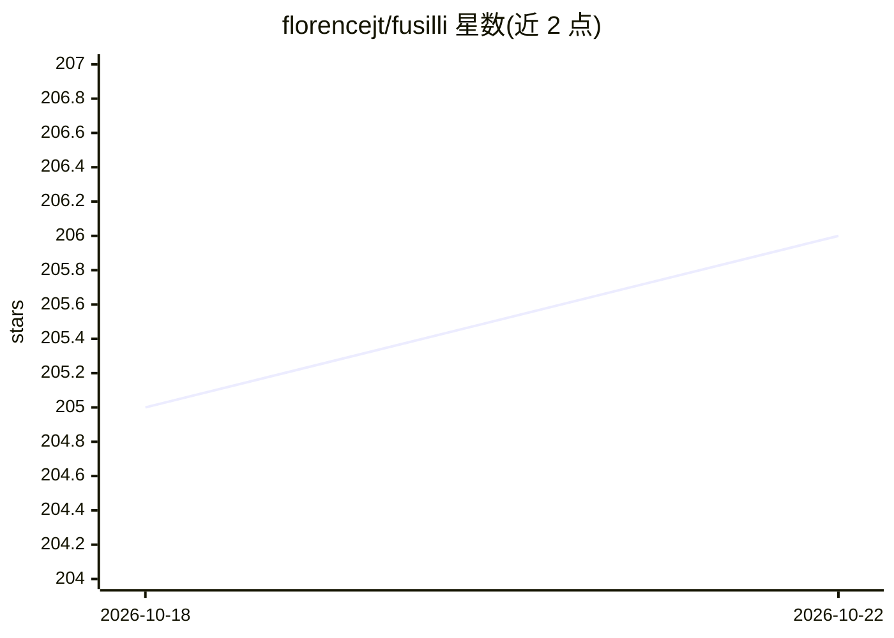

# florencejt/fusilli

⭐ 206 · Python · AGPL-3.0 · 推送 2026-07-30 · [GitHub](https://github.com/florencejt/fusilli) · [官网](https://fusilli.readthedocs.io/en/latest/) · 组织维护

**给科研者的多模态数据融合方法比较与训练库**

基于 PyTorch Lightning 与 PyTorch Geometric 构建的 Python 库，提供多模态数据融合的模型管线：覆盖数据加载、训练到评估全流程。支持 Tabular-Tabular 与 Tabular-Image（2D/3D）两类融合场景，预测任务含回归、二分类与多分类；不支持聚类或分割。定位是让使用者在一个平台上比较不同融合方法。以 pip 安装的 Python 包形式发布，附 Read the Docs 文档与引用条目（Zenodo DOI）。

## 筛选速览

| 维度 | 判定 | 备注 |
|---|---|---|
| AI 角色 | `ai-native` | 本体是模型或模型工具 |
| 许可风险 | `viral` | AGPL-3.0 |
| 部署形态 | `library` | 以包/库形式分发 |
| 模型依赖 | — | README 未给出锁定关系 |
| 硬件要求 | — | 无带数字的原话,不猜 |
| 安装摩擦 | `low` | 无编译、无系统依赖或容器化 |
| 成熟度 | — | 结构信号不足 |

## 能力要点

- Tabular-Tabular 与 Tabular-Image（2D/3D）两类融合场景
- 支持回归、二分类与多分类预测任务
- 基于 PyTorch Lightning 与 PyTorch Geometric 构建
- 覆盖数据加载、训练、评估全流程并提供可视化

## 适用场景

- 比较不同多模态融合方法在同一数据集上的表现
- 用表格数据加影像数据训练预测模型
- 医学研究中组合血液指标与神经影像做疾病预测

## 场景标签

 · 领域:机器学习/多模态数据融合

## 证据(README 行号)

> L20: Multi-modal data fusion is the combination of different types of data (or data modalities) in the pursuit of some c
> L25: Fusilli is built using PyTorch Lightning and PyTorch Geometric, and it currently supports the following scenarios:

## 星数曲线

2026-10-18 205 → 2026-10-22 206（+1）

---
*卡片 v1 · prompt 1.4 · 生成 2026-10-22 · 置信度 high · 依据 README sha `d068702b41df` · [字段定义](../../DATASET.md)*
