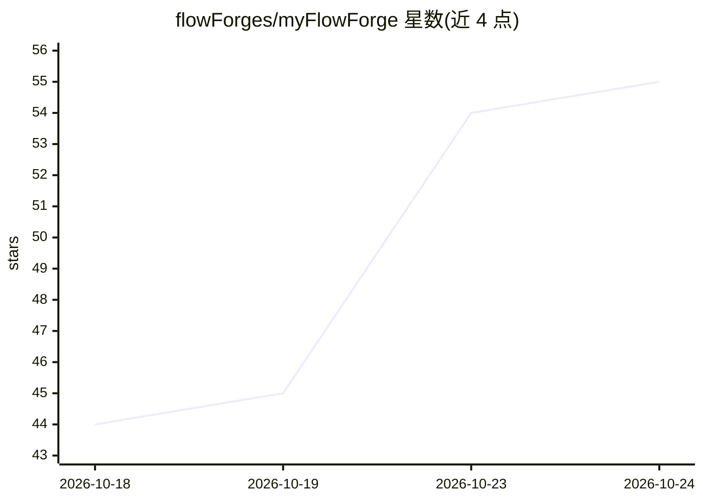

# flowForges/myFlowForge

⭐ 55 · TypeScript · MIT · 推送 2026-10-22 · [GitHub](https://github.com/flowForges/myFlowForge) · [官网](https://myflowforge.wzcu.com) · 个人维护 · 中文 README

**统一管理多家编码 agent CLI 的跨设备 GUI 层**

基于 Electron/React/TypeScript 的桌面应用，在本机已安装的官方编码 CLI（Claude Code、Codex、Cursor、Gemini、qoder、opencode、Qwen、Copilot、Kimi、DeepSeek 等 14 个）之上提供统一 GUI：同一会话内切换 agent 与模型、导入原生会话、阶段式工作流与按项目扇出、阶段 Hook、MCP 桥与技能市场。通过无头 Linux daemon、局域网直连/SSH/端到端加密中转连接远程主机，并有 iOS/Android 客户端。不修改、不替换 agent 本身，不保存 API key。个人维护，持续开发中。

## 筛选速览

| 维度 | 判定 | 备注 |
|---|---|---|
| AI 角色 | `ai-ecosystem` | LLM/agent 周边工具 |
| 许可风险 | `permissive` | MIT |
| 部署形态 | `desktop` | 安装包/桌面程序 |
| 模型依赖 | — | README 未给出锁定关系 |
| 硬件要求 | — | 无带数字的原话,不猜 |
| 安装摩擦 | `medium` | 含编译或系统依赖之一 |
| 成熟度 | `idea` | |

## 能力要点

- 驱动 14 个本机官方编码 CLI，不 fork、不保存 API key
- 同一会话内切换 agent、模型与权限档，上下文连续
- 阶段式工作流：审批、打回、按项目扇出到独立 git worktree 并行开发
- 多端互联：无头 daemon + 移动客户端，支持局域网直连/SSH/端到端加密中转（可自部署）

## 适用场景

- 多个 AI 编码 CLI 分散在不同终端，想在统一界面中管理会话与项目
- 从手机或另一台电脑远程查看 agent 对话、处理权限确认与审批
- 按阶段编排多 agent 工作流，让前后端在不同仓库并行开发

## 场景标签

`编码 Agent` `多智能体` · 领域:Agent 开发

## 证据(README 行号)

> L7: myFlowForge 直接调用本机已安装的官方 CLI（Claude Code、Codex、Cursor、Gemini、qoder、opencode、DeepSeek 等），不修改、不替换 agent 本身，只在其上提供一套统一的
> L29: - **原生接入**：通过官方 CLI 调用 agent，使用你自己的账号、订阅与本地配置。不 fork、不修改 agent，不保存 API key，也不代理任何请求。agent 升级后，新能力可直接使用。
> L39: 支持 14 个编码 CLI：**Claude Code · Codex · Cursor · Gemini · qoder · opencode · Qwen · Copilot · Pi · Kimi · Reasonix · 

## 星数曲线

2026-10-18 44 → 2026-10-24 55（+11）

---
*卡片 v1 · prompt 1.4 · 生成 2026-10-24 · 置信度 high · 依据 README sha `e639f299c2a0` · [字段定义](../../DATASET.md)*
