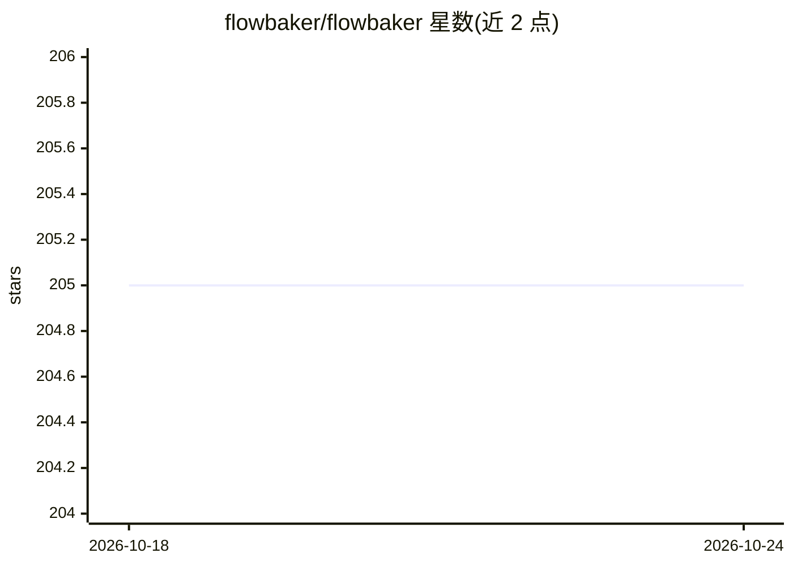

# flowbaker/flowbaker

⭐ 205 · Go · Apache-2.0 · 推送 2026-06-02 · [GitHub](https://github.com/flowbaker/flowbaker) · [官网](https://flowbaker.io) · 组织维护

**本地运行 Flowbaker 工作流的执行器，连接平台执行集成任务**

Flowbaker 无代码工作流自动化平台的执行引擎：作为二进制程序运行在用户本机，连接到 Flowbaker 平台的工作区，从仪表盘接收并执行分配的工作流，支持 Discord、GitHub、Gmail 等集成。首次启动提供交互式引导（创建执行器 ID、连接工作区、生成认证密钥），并附带 status/reset/workspaces 等管理命令。安装方式为下载发布版二进制或 Go 1.25+ 从源码编译。

## 筛选速览

| 维度 | 判定 | 备注 |
|---|---|---|
| AI 角色 | `ai-enhanced` | 去掉 AI 部分产品仍成立 |
| 许可风险 | `permissive` | Apache-2.0 |
| 部署形态 | `None` |  |
| 模型依赖 | — | README 未给出锁定关系 |
| 硬件要求 | — | 无带数字的原话,不猜 |
| 安装摩擦 | `low` | 无编译、无系统依赖或容器化 |
| 成熟度 | — | 结构信号不足 |

## 能力要点

- 在本机运行、从 Flowbaker 仪表盘接收工作流执行
- 支持 Discord、GitHub、Gmail 等集成
- 首次启动交互式引导（执行器 ID、工作区连接、认证密钥生成）
- 提供 start/status/reset/workspaces 命令集

## 适用场景

- 在自己机器上执行 Flowbaker 平台编排的工作流
- 通过本地执行器连接 Discord、GitHub、Gmail 等服务
- 自托管方式运行自动化任务的执行端

## 场景标签

`工作流自动化` · 领域:效率与自动化

## 证据(README 行号)

> L3: Workflow automation executor that runs on your machine. It connects to the Flowbaker platform to execute workflows w
> L33: Once setup is complete, the executor will run workflows assigned to it from your Flowbaker dashboard.

## 星数曲线

2026-10-18 205 → 2026-10-24 205（+0）

---
*卡片 v1 · prompt 1.4 · 生成 2026-10-22 · 置信度 mid · 依据 README sha `b38ae827fab4` · [字段定义](../../DATASET.md)*
