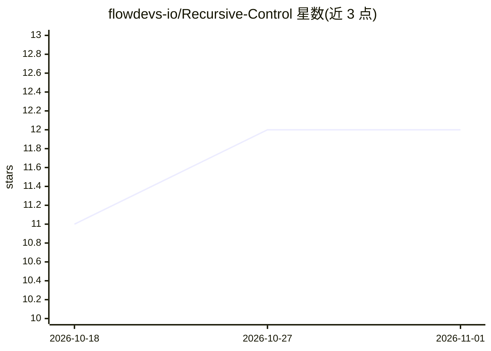

# flowdevs-io/Recursive-Control

⭐ 12 · C# · MIT · 推送 2025-11-29 · [GitHub](https://github.com/flowdevs-io/Recursive-Control) · 个人维护

**让 AI 通过自然语言自主操控 Windows 电脑的桌面代理**

面向 Windows 10+ 的 .NET 4.8 桌面程序：用户以自然语言下达指令，由 LLM（当前需 Azure OpenAI API Key）解读并调用内置插件执行命令行、PowerShell、键鼠自动化、屏幕截图、窗口操作等系统级动作。提供模块化插件系统（位于 FlowVision/lib/Plugins/，实现接口并注册即可扩展）。以 Releases 页面可执行文件安装为主，也可 git clone 后 dotnet restore/build 从源码构建。Gemini、Ollama、Bedrock 等模型支持列于 Roadmap，尚未实现。

## 筛选速览

| 维度 | 判定 | 备注 |
|---|---|---|
| AI 角色 | `ai-native` | 本体是模型或模型工具 |
| 许可风险 | `permissive` | MIT |
| 部署形态 | `desktop` | 安装包/桌面程序 |
| 模型依赖 | locked-api |  |
| 硬件要求 | — | 无带数字的原话,不猜 |
| 安装摩擦 | `medium` | 含编译或系统依赖之一 |
| 成熟度 | — | 结构信号不足 |

## 能力要点

- 自然语言驱动的电脑操控：开应用、执行命令、批量整理文件
- 内置 6 个插件：CMD/PowerShell/键盘/鼠标/截屏/窗口选择
- 模块化插件系统，实现接口并注册即可扩展
- MIT 许可，提供 Releases 可执行文件与源码构建两条路径

## 适用场景

- 用一句话让 AI 打开 Excel 并新建表格
- 自动化重复性的键鼠与命令行操作序列
- 截图并整理用于文档记录
- 通过编写插件扩展自定义自动化能力

## 场景标签

`GUI 自动化` `工作流自动化` · 领域:效率与自动化

## 证据(README 行号)

> L11: Our mission is to create an AI-driven interface that can autonomously control your computer, intelligently perform 
> L15: - **AI-Powered Interaction**: Utilize AI models (such as GPT-based models) to interpret user input and intelligentl

## 星数曲线

2026-10-18 11 → 2026-11-01 12（+1）

---
*卡片 v1 · prompt 1.4 · 生成 2026-11-01 · 置信度 high · 依据 README sha `1669ceaea79e` · [字段定义](../../DATASET.md)*
