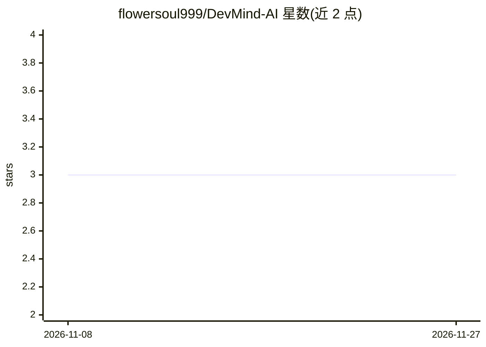

# flowersoul999/DevMind-AI

⭐ 3 · Python · 推送 2026-10-25 · [GitHub](https://github.com/flowersoul999/DevMind-AI) · 个人维护 · 中文 README

**面向 GitHub PR/Issue 研发协作的多 Agent 分析平台**

连接 GitHub 仓库同步 Issue、PR、Review 评论、CI 日志等数据，经向量/词法/结构化三路检索后由多 Agent 工作流（Planner → 专用 Agent → Observer → Synthesis）产出结构化分析与操作草稿；写操作只生成 ActionDraft 并需人工确认、全程留审计记录。技术栈为 FastAPI + Next.js + Milvus + PostgreSQL，docker-compose 仅编排基础设施，应用层需本地启动。作者声明为教学/作品集级别实现，多用户认证与迁移体系有简化，不适合作公网多租户服务上线。

## 筛选速览

| 维度 | 判定 | 备注 |
|---|---|---|
| AI 角色 | `ai-native` | 本体是模型或模型工具 |
| 许可风险 | `none` | — |
| 部署形态 | `self-host` | docker 或自建部署 |
| 模型依赖 | — | README 未给出锁定关系 |
| 硬件要求 | — | 无带数字的原话,不猜 |
| 安装摩擦 | `low` | 无编译、无系统依赖或容器化 |
| 成熟度 | `idea` | |

## 能力要点

- 多 Agent 工作流编排：Planner → 专用 Agent → Observer → Synthesis 闭环
- RAG 混合检索（Milvus 向量 + BM25 式关键词 + 结构化查询）与降级设计
- 高风险写操作一律草稿化，人工确认后执行并写审计日志
- 评测体系：基础 Eval + RAGAS 五项语义指标 + 回归对比

## 适用场景

- 提交 PR 前自查变更摘要、风险分级与合并就绪度
- CI 失败时定位失败 job、提取关键日志并给出排查步骤
- 新人通过 RAG 问答补业务上下文，返回带编号引用的答案
- 按仓库生成工程周报并支持多仓库合并汇总

## 场景标签

`多智能体` `RAG` `代码审查` `模型评测` · 领域:Agent 开发

## 证据(README 行号)

> L21: **DevFlow AI**（GitHub 仓库名 `DevMind-AI`）是一个面向 **GitHub PR / Issue 研发协作** 的全栈 AI Agent 项目。它连接仓库的真实数据，分析 Issue 描述、PR d
> L43: - 🔍 **PR 审查**：摘要、关键变更、P1/P2/P3 风险分级、检查清单、测试建议、重点关注文件、可合并性判断。
> L153: - ❌ **不适合作为公网多租户 SaaS 直接上线**：当前认证是演示级（见 FAQ）。

## 星数曲线

2026-11-08 3 → 2026-11-27 3（+0）

---
*卡片 v1 · prompt 1.4 · 生成 2026-11-22 · 置信度 mid · 依据 README sha `2cc762cf1c9a` · [字段定义](../../DATASET.md)*
