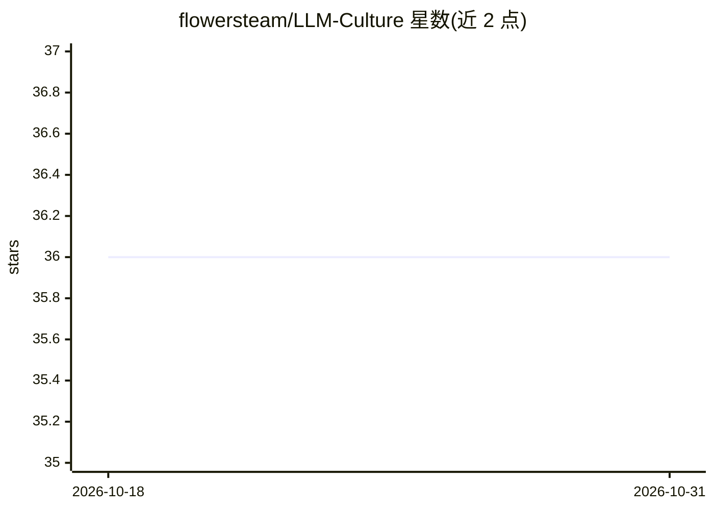

# flowersteam/LLM-Culture

⭐ 36 · Python · MIT · 推送 2026-10-15 · [GitHub](https://github.com/flowersteam/LLM-Culture) · 组织维护

**研究 LLM 群体文本文化演化的模拟框架**

用于研究 LLM 群体中文本文化演化的实验框架：将多个 agent 组织成网络（链、全连接、环、洞穴人子群），每个 agent 读取邻居的故事并按人格与转换提示词改写，经多代迭代观察文本漂移、收敛或分裂为子文化。支持 llama.cpp（本机）、vLLM（GPU）与托管 API 三种推理后端，实验用 YAML 预设配置，内置 TF-IDF/HuggingFace 嵌入相似度分析与七种图表，附 Colab notebook 与论文复现脚本，面向文化演化研究者。

## 筛选速览

| 维度 | 判定 | 备注 |
|---|---|---|
| AI 角色 | `ai-ecosystem` | LLM/agent 周边工具 |
| 许可风险 | `permissive` | MIT |
| 部署形态 | `None` |  |
| 模型依赖 | local-ok | 支持本地模型 |
| 硬件要求 | — | 无带数字的原话,不猜 |
| 安装摩擦 | `low` | 无编译、无系统依赖或容器化 |
| 成熟度 | — | 结构信号不足 |

## 能力要点

- agent 网络模拟：链/全连接/环/子群等结构与人格、传输规则可配
- 三种推理后端：llama.cpp 本机、vLLM GPU、托管 API
- 内置相似度指标与七种分析图表（TF-IDF 或 HuggingFace 嵌入）
- 提供论文复现脚本与 Colab notebook，另带本地 Flask Web 界面

## 适用场景

- 运行 LLM 传输链/迭代学习式文化演化实验
- 复现或扩展论文中的网络结构与转换提示实验
- 通过浏览器界面配置运行模拟并浏览分析图表

## 场景标签

`科研工具` · 领域:学习与行业

## 证据(README 行号)

> L3: A framework for studying the **cultural evolution of text in populations of LLMs**.
> L19: Agents are organized into a network. Each agent reads the stories of its neighbours
> L140: The experiment needs an LLM to generate the stories. There are three ways to provide

## 星数曲线

2026-10-18 36 → 2026-10-31 36（+0）

---
*卡片 v1 · prompt 1.4 · 生成 2026-10-25 · 置信度 high · 依据 README sha `a22ee70d26dd` · [字段定义](../../DATASET.md)*
