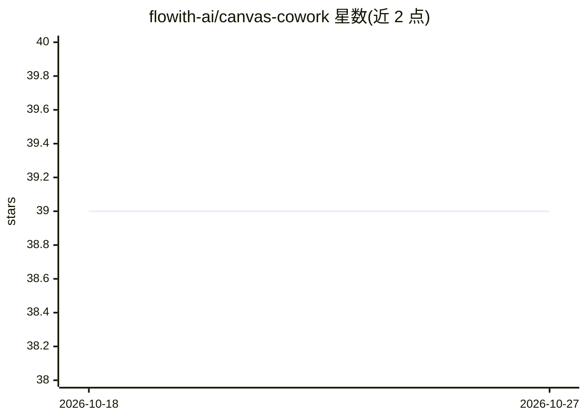

# flowith-ai/canvas-cowork

⭐ 39 · TypeScript · MIT · 推送 2026-10-20 · [GitHub](https://github.com/flowith-ai/canvas-cowork) · 组织维护

**从命令行在 Flowith 空间画布上生成图像/视频/文本的技能包**

面向 CLI、agent 与自动化流水线的 Flowith 画布操作工具：支持无头模式（纯 HTTP）与实时模式（画布上可见光标）。可创建画布、以全部模型参数（比例、尺寸、时长、分辨率、Seedance 引用等）生成图像与视频，上传多媒体文件，回读结果，并通过语义搜索跨画布召回历史工作。需 Flowith 账号与 Bun 运行时，也可直接调用 HTTP API。

## 筛选速览

| 维度 | 判定 | 备注 |
|---|---|---|
| AI 角色 | `ai-native` | 本体是模型或模型工具 |
| 许可风险 | `permissive` | MIT |
| 部署形态 | `library` | 以包/库形式分发 |
| 模型依赖 | — | README 未给出锁定关系 |
| 硬件要求 | — | 无带数字的原话,不猜 |
| 安装摩擦 | `low` | 无编译、无系统依赖或容器化 |
| 成熟度 | — | 结构信号不足 |

## 能力要点

- 无头（纯 HTTP）与实时两种工作模式
- 生成图像/视频时暴露全部模型参数，无需浏览器
- 跨画布语义搜索召回历史工作
- 提供 SKILL.md 命令参考与原始 HTTP API 文档

## 适用场景

- 让 Claude Code 等 agent 在空间画布上生成图像与视频
- 自动化流水线中无头调用画布生成能力
- 上传素材并回读画布节点结果

## 场景标签

`图像生成` `视频生成` `语义搜索` · 领域:内容生成

## 证据(README 行号)

> L3: Generate images and videos on Flowith's spatial canvas from the CLI — **headless** (plain HTTP, for agents and pipel
> L13: - **Generate** images and videos directly — every model parameter (ratio, size, quality, duration, resolution, audi

## 星数曲线

2026-10-18 39 → 2026-10-27 39（+0）

---
*卡片 v1 · prompt 1.4 · 生成 2026-10-25 · 置信度 high · 依据 README sha `2b837c79d15d` · [字段定义](../../DATASET.md)*
