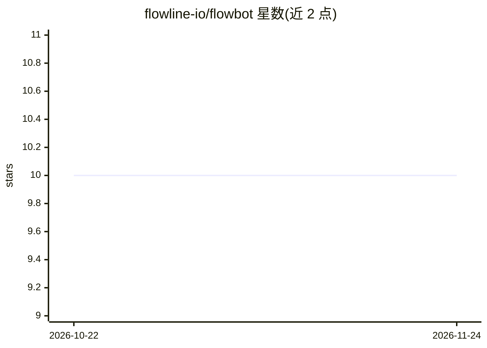

# flowline-io/flowbot

⭐ 10 · Go · GPL-3.0 · 推送 2026-11-23 · [GitHub](https://github.com/flowline-io/flowbot) · [官网](https://flowline-io.github.io) · 组织维护

**自托管应用数据枢纽：统一调用各应用能力并跨应用自动化**

面向自托管（homelab）环境的数据枢纽：扫描 docker-compose.yaml 发现运行中的应用，把 karakeep、miniflux、gitea 等服务统一封装在 capability.Invoke API 之后，通过 Pipelines（事件驱动）与 Workflows（YAML DAG）编排跨应用流程，并可用 Agents 提供对话式循环。交互入口覆盖 Web UI、REST、CLI、聊天平台（Discord/Slack/Tailchat）与 MCP（Streamable HTTP）。执行记录持久化到 PostgreSQL 并经 Redis Stream 分发，提供健康探针、审计日志与 OAuth 2.0/scope 鉴权。

## 筛选速览

| 维度 | 判定 | 备注 |
|---|---|---|
| AI 角色 | `ai-enhanced` | 去掉 AI 部分产品仍成立 |
| 许可风险 | `viral` | GPL-3.0 |
| 部署形态 | `self-host` | docker 或自建部署 |
| 模型依赖 | — | README 未给出锁定关系 |
| 硬件要求 | — | 无带数字的原话,不猜 |
| 安装摩擦 | `low` | 无编译、无系统依赖或容器化 |
| 成熟度 | — | 结构信号不足 |

## 能力要点

- 扫描 docker-compose.yaml 发现应用、能力与健康状态
- 统一 capability.Invoke API 覆盖 15+ 服务集成
- YAML 声明式 Pipeline/Workflow（capability/docker/shell/machine/mapper 前缀）
- MCP 客户端可经 /mcp 端点访问同一批能力

## 适用场景

- 把散落的自托管服务从一处统一调用和编排
- 用事件驱动的管道替代一次性胶水脚本
- 通过 Discord/Slack 聊天触发跨应用自动化
- 为自托管能力暴露 MCP 接口给客户端

## 场景标签

`工作流自动化` `聊天机器人` · 领域:效率与自动化

## 证据(README 行号)

> L7: Flowbot scans your self-hosted stack, wraps each integrated service behind one `capability.Invoke` API, and runs cro
> L20: |Need Web, CLI, chat, cron, and webhooks|Same capabilities on every surface — plus Agents when you want a conversat
> L116: - Go 1.27.1+

## 星数曲线

2026-10-22 10 → 2026-11-24 10（+0）

---
*卡片 v1 · prompt 1.4 · 生成 2026-11-19 · 置信度 mid · 依据 README sha `8c784ab38eb9` · [字段定义](../../DATASET.md)*
