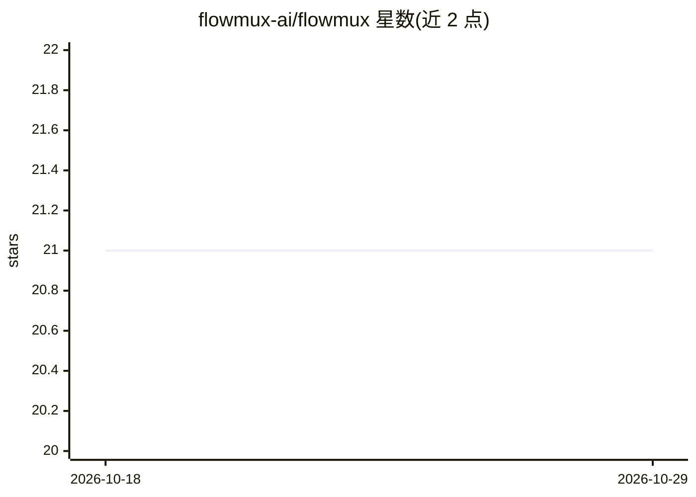

# flowmux-ai/flowmux

⭐ 21 · Rust · GPL-3.0 · 推送 2026-10-28 · [GitHub](https://github.com/flowmux-ai/flowmux) · [官网](https://flowmux.org) · 组织维护

**面向 AI 编程 Agent 的终端复用器：并排运行多个 Agent 并提供通知与浏览器**

运行于 Linux 与 macOS 的终端应用，用于并排管理多个 AI 编程 Agent：每个 Agent 占一个工作区，任务完成或需审批时发出桌面通知并可点击跳转。内置可被 Agent 通过 flowmux CLI 控制的 WebKit 浏览器标签（可选 WebDriver 自动化）、分屏与总览模式、Git worktree 面板、Claude/Codex 用量显示、Code Review 反馈发送给 Agent、终端输出跨工作区搜索、SSH 远程工作区，以及由一个主 Agent 调度 Claude Code/Codex 工作进程的 Team workspace 和像素风 AgentOffice 状态视图。通过 curl 安装脚本或源码构建安装，GPL-3.0-or-later 许可。macOS Apple Silicon 为预览版。

## 筛选速览

| 维度 | 判定 | 备注 |
|---|---|---|
| AI 角色 | `ai-ecosystem` | LLM/agent 周边工具 |
| 许可风险 | `viral` | GPL-3.0 |
| 部署形态 | `None` |  |
| 模型依赖 | — | README 未给出锁定关系 |
| 硬件要求 | — | 无带数字的原话,不猜 |
| 安装摩擦 | `low` | 无编译、无系统依赖或容器化 |
| 成熟度 | `idea` | |

## 能力要点

- Claude Code/Codex/OpenCode/Gemini CLI/Antigravity CLI 任务通知与跳转
- flowmux browser CLI 允许 Agent 在可视窗格中打开/读取/填写网页
- Team workspace：主 Agent 调度多个 Claude Code/Codex 工作进程并汇总结果
- SSH 远程工作区与跨工作区终端输出搜索

## 适用场景

- 同时跑多个 AI 编程 Agent 并在它们需要我时收到通知
- 让 Agent 在我可见的浏览器窗格里完成网页操作
- 用一个主 Agent 协调多个 worker 完成研究与实现任务

## 场景标签

`编码 Agent` · 领域:编码与开发

## 证据(README 行号)

> L16: Run AI coding agents side by side, with terminals, browser tabs, and task
> L37: Know which agent needs you. When Claude Code, Codex, OpenCode, Gemini CLI,

## 星数曲线

2026-10-18 21 → 2026-10-29 21（+0）

---
*卡片 v1 · prompt 1.4 · 生成 2026-10-28 · 置信度 high · 依据 README sha `f55b4f8dc571` · [字段定义](../../DATASET.md)*
