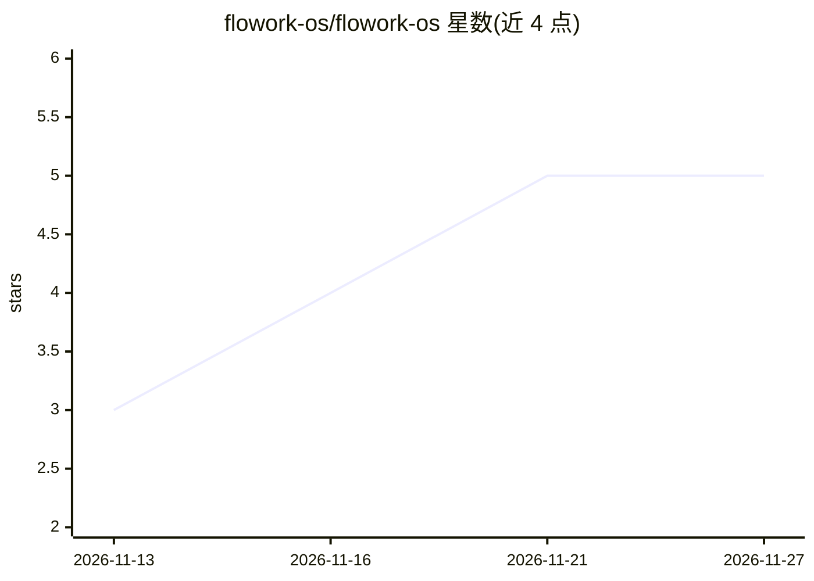

# flowork-os/flowork-os

⭐ 5 · Python · NOASSERTION · 推送 2026-11-23 · [GitHub](https://github.com/flowork-os/flowork-os) · [官网](https://floworkos.com) · 个人维护

**面向桌面用户的自主 AI 代理操作系统，内置 Android/Wine 与 USB 启动**

一个 Linux 发行版形态的桌面系统，将自主 AI 代理（Mr. Flow）集成进桌面环境，代理具备执行终端命令、写文件、操作 GUI 的能力，并可自检报错循环修复。系统内置原生 Android APK 子系统、wine-staging 环境运行 Windows 程序、Blender IPC 桥接做 3D 自动化、60 秒短视频生成流水线、320+ 逆向工程工具与反检测浏览器。提供 Live USB 免安装运行，API 账户存本地加密库并多账户轮换。ISO 分卷下载后经 Rufus/BalenaEtcher 刷写启动。

## 筛选速览

| 维度 | 判定 | 备注 |
|---|---|---|
| AI 角色 | `ai-native` | 本体是模型或模型工具 |
| 许可风险 | `none` | NOASSERTION |
| 部署形态 | `desktop` | 安装包/桌面程序 |
| 模型依赖 | — | README 未给出锁定关系 |
| 硬件要求 | — | 无带数字的原话,不猜 |
| 安装摩擦 | `medium` | 含编译或系统依赖之一 |
| 成熟度 | — | 结构信号不足 |

## 能力要点

- 自主代理具备命令执行、文件写入与桌面 GUI 操作能力，含报错自修复循环
- 原生 Android APK 子系统（flowork-apk）与代理驱动的应用自动化（apk-actuator）
- 多账户 Failover 加密库，按延迟与限流状态自动轮换 API 账户
- 320+ clean-room 逆向工具与内核级 DNS 广告过滤

## 适用场景

- 用 U 盘在现有 Windows/macOS 机器上免安装试用一个带 AI 代理的桌面系统
- 在桌面端直接运行并自动化操作 Android APK 应用
- 通过自然语言指令让代理建模 3D 资产或生成短视频
- 反编译 APK、检查 ELF/PE 二进制等逆向分析

## 场景标签

`视频生成` `GUI 自动化` `网络安全` · 领域:效率与自动化

## 证据(README 行号)

> L3:  Autonomous AI Operating System (AI OS)
> L22: > Instead of spending hours juggling terminal commands, broken Python environments, expensive AI subscriptions, blo
> L39: * **The Flowork Solution:** Mr. Flow has direct system and GUI actuation authority (`desktop_actuator`, `run_comman

## 星数曲线

2026-11-13 3 → 2026-11-27 5（+2）

---
*卡片 v1 · prompt 1.4 · 生成 2026-11-21 · 置信度 high · 依据 README sha `5e130df100b2` · [字段定义](../../DATASET.md)*
