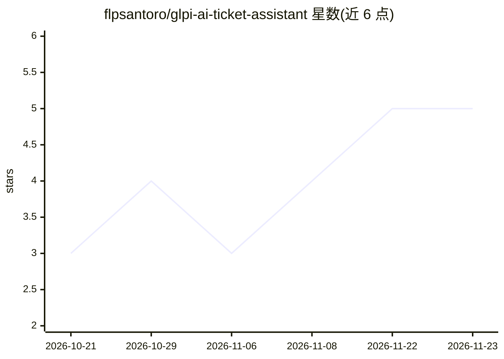

# flpsantoro/glpi-ai-ticket-assistant

⭐ 5 · PHP · GPL-2.0 · 推送 2026-10-15 · [GitHub](https://github.com/flpsantoro/glpi-ai-ticket-assistant) · 个人维护

**面向 GLPI 技术员的 AI 工单助手插件：读取工单并生成回复草稿**

GLPI 10/11/12 的 GPL v2+ 社区插件，为 ITSM 技术员提供工单分析：读取工单全文与附件（图片/PDF/Office/日志），生成诊断、排查步骤与回复草稿；通过已解决工单构建检索式案例库（全文+可选 embeddings），给出类型/分类/紧急度建议并在自有历史上测量准确率。治理机制包括预算限额、审计日志、脱敏、API 密钥加密。'学习'为检索而非微调，所有文本均为草稿、不自动发送给请求方。

## 筛选速览

| 维度 | 判定 | 备注 |
|---|---|---|
| AI 角色 | `ai-native` | 本体是模型或模型工具 |
| 许可风险 | `viral` | GPL-2.0 |
| 部署形态 | `self-host` | docker 或自建部署 |
| 模型依赖 | local-ok | 支持本地模型 |
| 硬件要求 | — | 无带数字的原话,不猜 |
| 安装摩擦 | `low` | 无编译、无系统依赖或容器化 |
| 成熟度 | — | 结构信号不足 |

## 能力要点

- 读取整条工单时间线的文本与附件（图片走 vision，PDF/Office/日志提取文本）
- 从已解决工单构建检索案例库，无微调实现分类建议并测量 top-1/top-3 准确率
- 内置治理：日预算、按人小时限额、审计日志、秘密与个人数据脱敏、密钥加密
- 支持云端与 100% 本地运行（Ollama、LM Studio、vLLM 等 OpenAI 兼容服务器）

## 适用场景

- 服务台技术员让 AI 起草回复与排查策略，再人工确认发送
- 按历史已解决工单自动预分类新工单（含邮件创建的）
- 从已解决工单生成待审核的知识库文章
- 在内网无云环境下用本地模型跑工单助手

## 场景标签

`文档解析` `RAG` `知识库管理` · 领域:知识与检索

## 证据(README 行号)

> L8: **An AI assistant for GLPI technicians.** It reads the whole ticket — text, history, screenshots
> L28: - **Learns from solved tickets, without fine-tuning.** Solved tickets become a searchable case
> L35: - **Any provider.** OpenAI, Azure OpenAI, Anthropic, Google Gemini, Mistral, OpenRouter, Ollama

## 星数曲线

2026-10-21 3 → 2026-11-23 5（+2）

---
*卡片 v1 · prompt 1.4 · 生成 2026-11-21 · 置信度 high · 依据 README sha `c1d3dc8e3a8c` · [字段定义](../../DATASET.md)*
