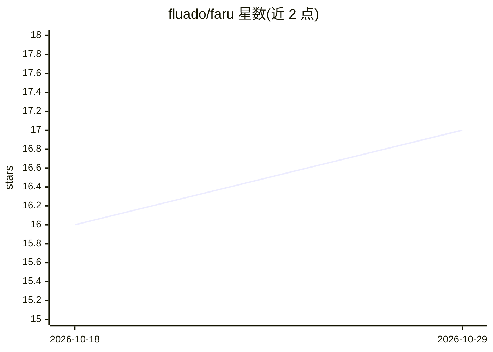

# fluado/faru

⭐ 17 · JavaScript · MIT · 推送 2026-10-20 · [GitHub](https://github.com/fluado/faru) · [官网](https://fluado.com) · 个人维护

**面向 AI agent 团队的 git 原生看板：卡片即 markdown 文件**

看板工具：卡片以 backlog/ 目录下的 markdown 文件（YAML frontmatter）存储，看板实时渲染并支持拖拽、内联编辑，变更自动 git 提交推送。为 agent 执行工作、人类把关的团队设计：提供把卡片分派给 AI 编码 agent 的驱动（Antigravity/Cursor/Claude Code），技能以 markdown 定义并可链式执行、附带自查审计；Dojo 模块以 cron 调度周期性 agent 任务（kata）并生成 sweep 报告。无 agent 驱动时看板仍可独立使用，仅禁用分派。通过 npx 从 GitHub 运行，配置分为共享 faru.config.json 与本机 .faru.local.json。

## 筛选速览

| 维度 | 判定 | 备注 |
|---|---|---|
| AI 角色 | `ai-enhanced` | 去掉 AI 部分产品仍成立 |
| 许可风险 | `permissive` | MIT |
| 部署形态 | `library` | 以包/库形式分发 |
| 模型依赖 | — | README 未给出锁定关系 |
| 硬件要求 | — | 无带数字的原话,不猜 |
| 安装摩擦 | `low` | 无编译、无系统依赖或容器化 |
| 成熟度 | `idea` | |

## 能力要点

- 卡片为 markdown 文件夹 + YAML frontmatter，全部状态存于 git 并自动提交推送
- 可将卡片按技能链分派给 Antigravity/Cursor/Claude Code，技能执行后可发起自查审计
- milestones 文件自动跟踪进度，报告文件存在即判定完成
- Dojo 调度器按 cron 运行周期性 agent 任务并生成时间线 sweep 报告

## 适用场景

- 让 agent 与人共用同一 git 仓库看板协作管理任务
- 把卡片任务自动分派给 AI 编码 agent 执行与审计
- 定时调度 agent 做周期性巡检并将发现转为卡片

## 场景标签

 · 领域:开发者工具/项目管理

## 证据(README 行号)

> L9: Built for teams where agents do the work and humans steer. Agents create and manage cards as markdown files, the boa
> L176: faru ships with drivers that dispatch cards to an AI coding agent:

## 星数曲线

2026-10-18 16 → 2026-10-29 17（+1）

---
*卡片 v1 · prompt 1.4 · 生成 2026-10-29 · 置信度 high · 依据 README sha `3f7c93e01942` · [字段定义](../../DATASET.md)*
