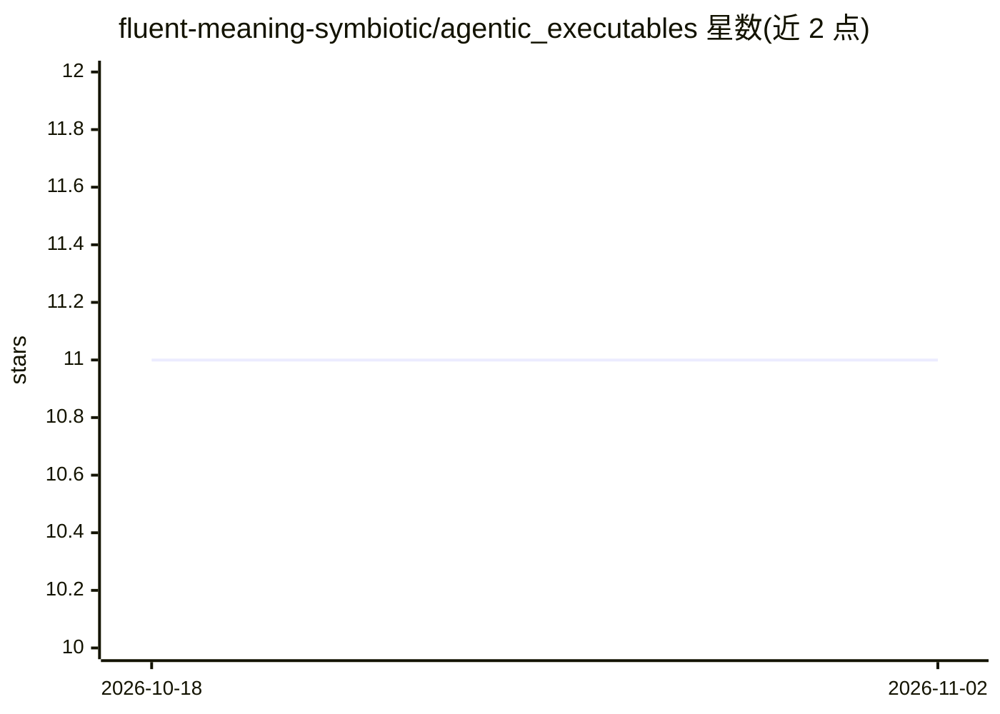

# fluent-meaning-symbiotic/agentic_executables

⭐ 11 · Dart · NOASSERTION · 推送 2026-10-26 · [GitHub](https://github.com/fluent-meaning-symbiotic/agentic_executables) · [官网](https://agentic-executables.web.app/) · 组织维护

**把领域知识转成可执行指令的框架，供人类与 AI agent 共用**

AE 是一个开源框架，从规格、文档或 git 仓库中提取领域知识，并生成确定性的 install/uninstall/update/use 生命周期指令，使人类和 AI agent 执行同一套工作流。核心能力为 Know（知识提取与存储）与 Use（生成生命周期文件），支持本地优先离线 hub、远程 registry 同步与可选部署打包。提供 CLI 与 MCP 服务器两种使用形式，兼容任何支持 MCP 的 agent/IDE（Claude、Cursor、VS Code Copilot、Codex 等）。v3.x 处于 beta，API 可能变动。通过 curl 安装脚本或 Dart 源码运行。

## 筛选速览

| 维度 | 判定 | 备注 |
|---|---|---|
| AI 角色 | `ai-ecosystem` | LLM/agent 周边工具 |
| 许可风险 | `permissive` | NOASSERTION |
| 部署形态 | `None` |  |
| 模型依赖 | — | README 未给出锁定关系 |
| 硬件要求 | — | 无带数字的原话,不猜 |
| 安装摩擦 | `low` | 无编译、无系统依赖或容器化 |
| 成熟度 | `idea` | |

## 能力要点

- 从 URL/仓库/文件（含 PDF）提取领域知识并存入本地 hub
- 生成确定性 install/uninstall/update/use 生命周期指令
- CLI 与 MCP 服务器（8 个工具）双形态，兼容 MCP 生态
- 本地优先离线工作，可同步远程 registry 并产出部署 JSON

## 适用场景

- 把项目文档转成人和 AI agent 都能执行的标准化安装/更新流程
- 为支持 MCP 的 IDE/agent（Claude、Cursor 等）提供统一知识接口
- 沉淀领域知识并在团队/registry 间分发复用

## 场景标签

`Agent 框架` · 领域:Agent 开发

## 证据(README 行号)

> L24: AE is an open framework that extracts domain knowledge and turns it into executable lifecycle instructions. It work
> L98: ## MCP Tools
> L122: AE works with any AI agent or IDE that supports MCP: Claude, Cursor, VS Code Copilot, Codex, and more.

## 星数曲线

2026-10-18 11 → 2026-11-02 11（+0）

---
*卡片 v1 · prompt 1.4 · 生成 2026-11-02 · 置信度 high · 依据 README sha `8650df915059` · [字段定义](../../DATASET.md)*
