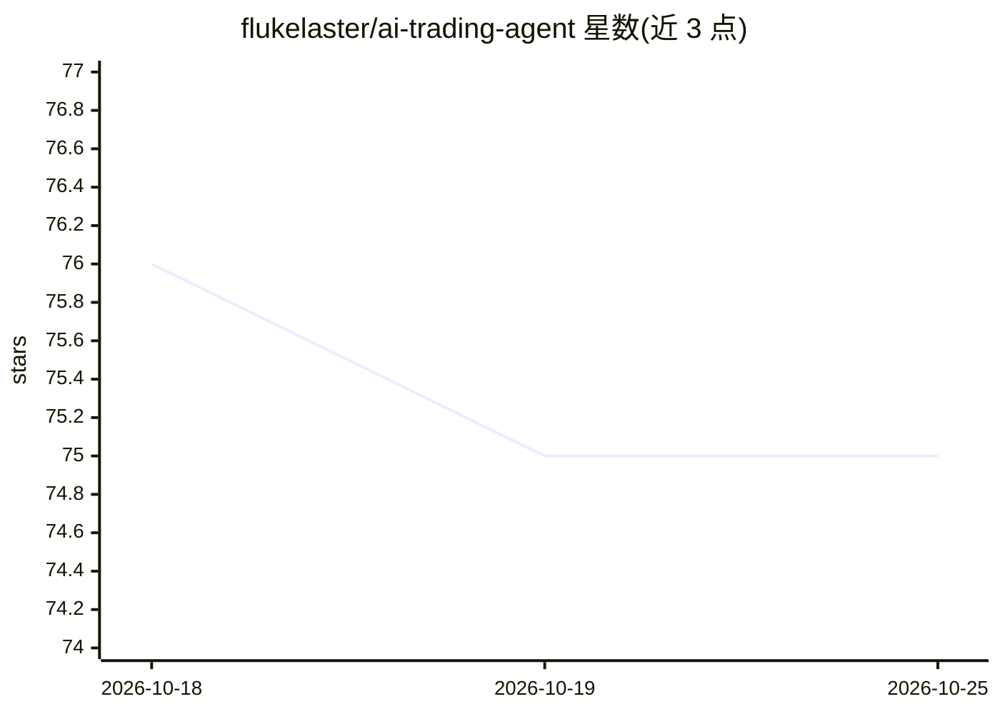

# flukelaster/ai-trading-agent

⭐ 75 · Python · 推送 2026-05-03 · [GitHub](https://github.com/flukelaster/ai-trading-agent) · 个人维护

**多品种自动交易平台：8 个 Claude 智能体经 MetaTrader 5 交易**

面向个人量化交易者的多品种自动交易平台，通过 MT5 桥接交易 GOLD、OILCash、BTCUSD、USDJPY。核心机制为 8 个专业 Claude 智能体（编排、技术、基本面、风险、情绪、反思等）协作决策，辅以 LightGBM 信号模型与 5 策略集成；MCP 工具层设不可绕过的风险限额（手数、日亏损、频率、冷却）。提供 Next.js 实时仪表盘、回测工作室、Token 成本追踪，支持 shadow/paper/micro/live 四档渐进上线。后端 FastAPI + PostgreSQL + Redis，实盘需 Windows VPS 运行 MetaTrader 5。许可证为私有、仅供内部使用。

## 筛选速览

| 维度 | 判定 | 备注 |
|---|---|---|
| AI 角色 | `ai-native` | 本体是模型或模型工具 |
| 许可风险 | `none` | — |
| 部署形态 | `self-host` | docker 或自建部署 |
| 模型依赖 | locked-api |  |
| 硬件要求 | — | 无带数字的原话,不猜 |
| 安装摩擦 | `low` | 无编译、无系统依赖或容器化 |
| 成熟度 | — | 结构信号不足 |

## 能力要点

- 8 个 Claude 智能体协作决策（Sonnet + Haiku）
- MCP 工具层不可绕过的风险护栏（手数/日亏损/频率/冷却）
- LightGBM 逐品种模型（40+ 特征、漂移检测、自动再训练）
- Shadow→Paper→Micro-Live→Live 渐进上线模式

## 适用场景

- 用多智能体 AI 自动交易黄金、原油、比特币与美元日元
- 在实盘前用影子/纸面模式验证策略
- 在仪表盘中实时监控持仓、盈亏与每智能体 Token 成本

## 场景标签

`多智能体` `金融量化` · 领域:Agent 开发

## 证据(README 行号)

> L5: **Multi-symbol autonomous trading platform powered by Claude AI agents**
> L22: > Eight specialist Claude agents collaborating on a virtual trading floor — Orchestrator, Technical, Fundamental, R
> L34: |🧠 **Multi-Agent AI**|8 specialist Claude agents (Sonnet + Haiku) — Orchestrator + Technical + Fundamental + Risk +

## 星数曲线

2026-10-18 76 → 2026-10-25 75（-1）

---
*卡片 v1 · prompt 1.4 · 生成 2026-10-24 · 置信度 mid · 依据 README sha `45dc9fa8b8af` · [字段定义](../../DATASET.md)*
