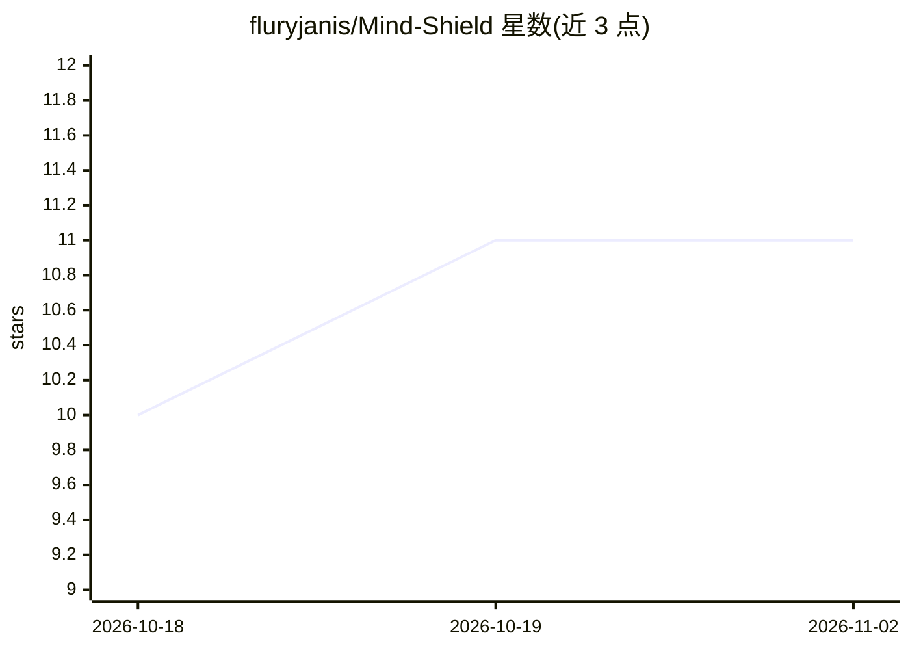

# fluryjanis/Mind-Shield

⭐ 11 · HTML · MIT · 推送 2026-10-10 · [GitHub](https://github.com/fluryjanis/Mind-Shield) · [官网](https://fluryjanis.github.io/Mind-Shield/) · 个人维护

**浏览器扩展：在向 AI 提简单问题时加入反思停顿**

面向普通 AI 用户的 Chrome/Firefox 浏览器扩展：用户在 ChatGPT、Claude、Gemini、Grok 输入提示词时，本地运行的 WebAssembly 机器学习模型（基于 DistilBERT-MNLI）评估提示词结构；判断为简单捷径类请求时引入短暂反思停顿，复杂任务（研究、调试、学习等）则直接提交。所有提示词评估在设备本地完成，无云端分析、无追踪。项目自述为实验性项目，Chrome 需手动加载未打包扩展安装。

## 筛选速览

| 维度 | 判定 | 备注 |
|---|---|---|
| AI 角色 | `ai-native` | 本体是模型或模型工具 |
| 许可风险 | `permissive` | MIT |
| 部署形态 | `None` |  |
| 模型依赖 | — | README 未给出锁定关系 |
| 硬件要求 | — | 无带数字的原话,不猜 |
| 安装摩擦 | `low` | 无编译、无系统依赖或容器化 |
| 成熟度 | `idea` | |

## 能力要点

- 本地 WebAssembly 运行 DistilBERT-MNLI 分类提示词
- 支持 ChatGPT / Claude / Gemini / Grok 四个平台
- 提示词评估全程本地处理，无云端分析、无追踪
- 仅对简单捷径类请求引入反思停顿，复杂任务直接放行

## 适用场景

- 减少随手把简单问题交给 AI 的习惯
- 在继续用 AI 的同时练习自己思考和计算
- 防止过度依赖 AI 导致的批判性思维退化

## 场景标签

 · 领域:浏览器扩展/生产力工具

## 证据(README 行号)

> L52: A machine-learning model running locally in your browser evaluates the structure of your prompt.
> L87: Prompt evaluation happens **on your device** using an on-device machine-learning model compiled for WebAssembly.
> L103: `DistilBERT-MNLI`

## 星数曲线

2026-10-18 10 → 2026-11-02 11（+1）

---
*卡片 v1 · prompt 1.4 · 生成 2026-11-02 · 置信度 high · 依据 README sha `ea440827388b` · [字段定义](../../DATASET.md)*
