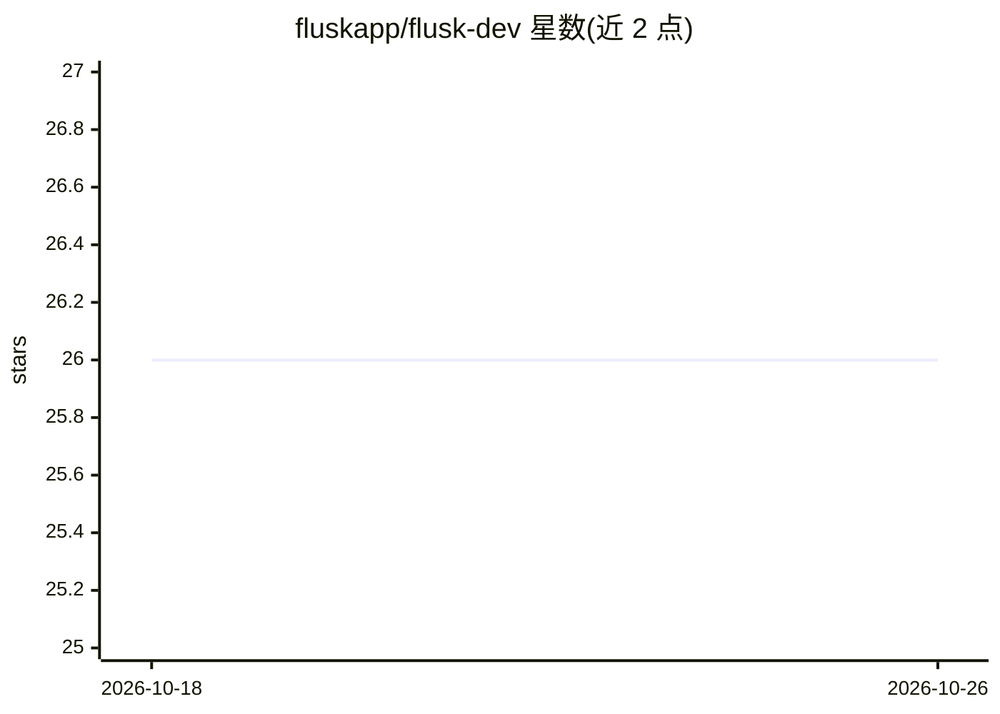

# fluskapp/flusk-dev

⭐ 26 · TypeScript · Apache-2.0 · 推送 2026-08-18 · [GitHub](https://github.com/fluskapp/flusk-dev) · [官网](https://flusk.dev) · 个人维护

**自主编程代理：自带引擎、工作台与本地记忆的命令行 agent**

自主编码代理 CLI，非其他 agent CLI 的封装：自带 turn/tool/session 引擎，每次运行在隔离 git 分支上并逐轮 checkpoint。学到的东西（验证命令、跨仓库经验、目标图、无人值守台账）写入本地双时序事实存储。面向无人值守场景提供四层安全模型（命令分类、写 jail、git 隔离、预算），运行结束强制执行仓库验证命令并核对 agent 报告，未验证即声称通过会被 block。需 Node>=22，经 npm 构建运行，默认 provider 需 ANTHROPIC_API_KEY，测试套件可用脚本化假 provider 离线运行。

## 筛选速览

| 维度 | 判定 | 备注 |
|---|---|---|
| AI 角色 | `ai-native` | 本体是模型或模型工具 |
| 许可风险 | `permissive` | Apache-2.0 |
| 部署形态 | `library` | 以包/库形式分发 |
| 模型依赖 | locked-api |  |
| 硬件要求 | — | 无带数字的原话,不猜 |
| 安装摩擦 | `low` | 无编译、无系统依赖或容器化 |
| 成熟度 | `idea` | |

## 能力要点

- 自带循环引擎，每次运行隔离在独立 git 分支并逐轮 checkpoint
- 本地双时序事实存储保存跨会话经验，知识超出上下文窗口存活
- 四层安全模型：命令分类、文件写 jail、git 隔离、成本/轮数/时限预算
- 结束时执行仓库验证命令并核对 agent 报告，未验证的声明被 block

## 适用场景

- 让 agent 在隔离分支上自动完成编码任务并审查整体 diff
- 无人值守队列模式处理 GitHub PR 与 CI 失败
- 跨会话积累仓库知识并按目标图逐任务推进

## 场景标签

`编码 Agent` `Agent 记忆` · 领域:Agent 开发

## 证据(README 行号)

> L5: flusk is not a wrapper around another agent CLI. It runs its own
> L37: (`ANTHROPIC_API_KEY` for the defaults); `--fake` replays a scripted transcript

## 星数曲线

2026-10-18 26 → 2026-10-26 26（+0）

---
*卡片 v1 · prompt 1.4 · 生成 2026-10-26 · 置信度 high · 依据 README sha `f7ecd53e5307` · [字段定义](../../DATASET.md)*
