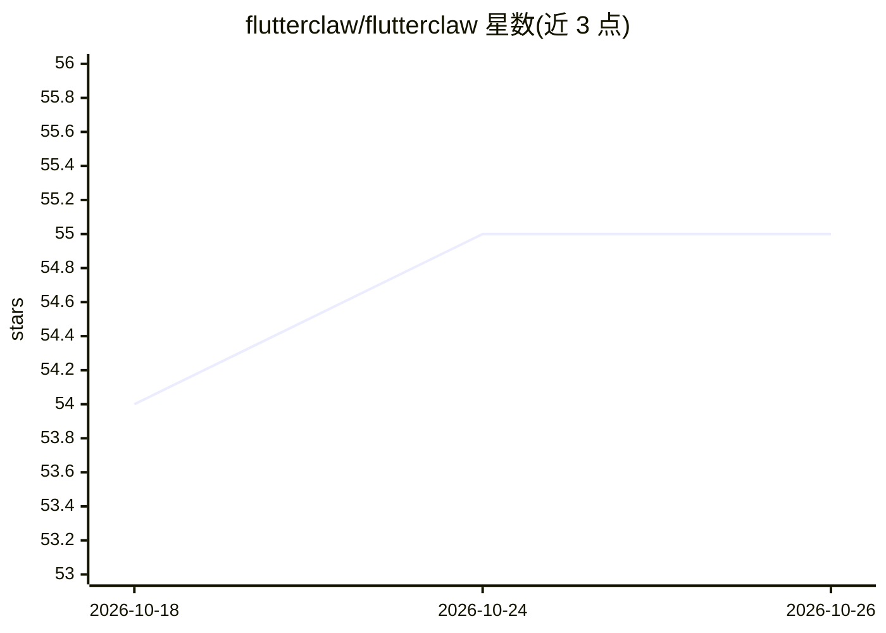

# flutterclaw/flutterclaw

⭐ 55 · Dart · MIT · 推送 2026-06-13 · [GitHub](https://github.com/flutterclaw/flutterclaw) · [官网](https://flutterclaw.ai) · 组织维护

**在手机上独立运行的 OpenClaw 移植 AI 助手（Android/iOS）**

用 Flutter 实现的移动端 AI 助手应用，将 OpenClaw 的 WebSocket 网关与 agent 运行时完整运行在 Android/iOS 设备上，而非薄客户端。支持 11 家 LLM 提供商（OpenAI/Anthropic/Bedrock/Ollama 等），内置 40+ 工具与可选 MCP 服务器扩展，提供多 agent 管理、子 agent 编排，以及 Telegram、Discord、WhatsApp、Slack、Signal 等多通道消息接入。设备能力覆盖定位、健康数据、相机、日历、UI 自动化等。Android 端通过 PRoot 提供 Alpine 风格沙箱。README 自述处于早期 alpha 阶段，需从源码构建（Flutter/Dart 3.11+），iOS 构建需 macOS 与 Xcode。

## 筛选速览

| 维度 | 判定 | 备注 |
|---|---|---|
| AI 角色 | `ai-native` | 本体是模型或模型工具 |
| 许可风险 | `permissive` | MIT |
| 部署形态 | `None` |  |
| 模型依赖 | local-ok | 支持本地模型 |
| 硬件要求 | — | 无带数字的原话,不猜 |
| 安装摩擦 | `medium` | 含编译或系统依赖之一 |
| 成熟度 | `idea` | |

## 能力要点

- 完整 OpenClaw 网关与 agent 运行时运行于设备端（localhost:18789 WebSocket）
- 11 家 LLM 提供商接入，含 OpenRouter 免费模型
- 多通道消息适配：Telegram、Discord、WhatsApp、Slack、Signal、WebChat
- 40+ 内置工具调用原生设备能力（GPS、健康、相机、UI 自动化、沙箱 shell）

## 适用场景

- 在手机上 7×24 运行个人 AI 助手并接入常用聊天平台
- 让 agent 使用手机定位、健康、日历等原生能力执行任务
- 通过多 agent 与子 agent 编排处理复杂任务

## 场景标签

`AI 助手` `多智能体` · 领域:Agent 开发

## 证据(README 行号)

> L5: Standalone AI assistant for Android and iOS — the full OpenClaw gateway and agent runtime, running entirely on your 
> L48: - **Multi-provider LLM support**: OpenAI, Anthropic, AWS Bedrock, Groq, DeepSeek, Gemini, Zhipu, OpenRouter, Volcen
> L46: - **Standalone gateway + agent** running 24/7 in the background (Android foreground service, iOS background modes)

## 星数曲线

2026-10-18 54 → 2026-10-26 55（+1）

---
*卡片 v1 · prompt 1.4 · 生成 2026-10-24 · 置信度 high · 依据 README sha `c2caad6678f8` · [字段定义](../../DATASET.md)*
