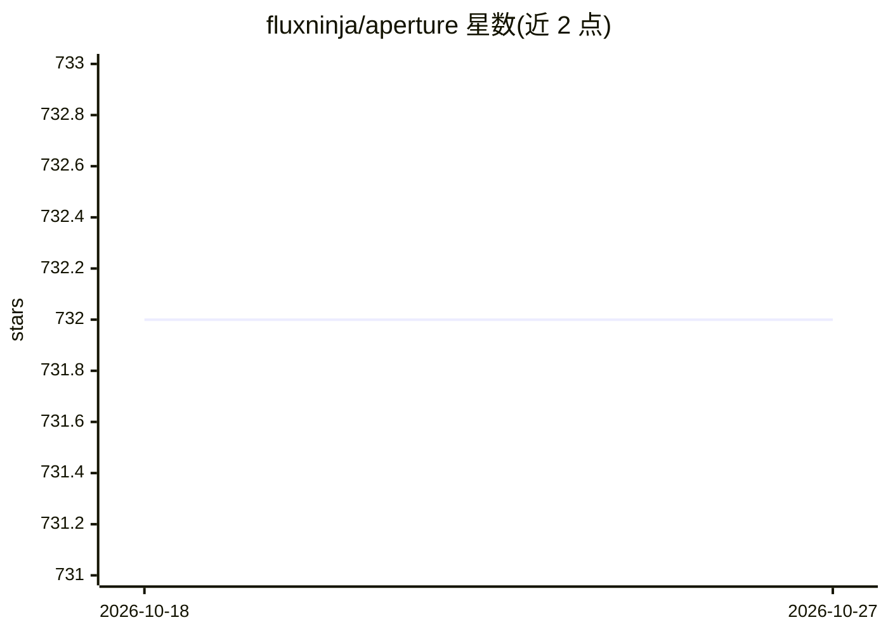

# fluxninja/aperture

⭐ 732 · Go · Apache-2.0 · 推送 2025-12-21 · [GitHub](https://github.com/fluxninja/aperture) · [官网](https://docs.fluxninja.com) · 组织维护

**面向云应用的分布式负载管理平台：限流、缓存与请求优先级**

Aperture 提供分布式限流、并发控制、API 配额管理、工作负载优先级调度与缓存能力，构建在分布式计数器、可观测性与全局控制面之上。应用通过语言 SDK 以定义标签、startFlow/endFlow 包裹工作负载、配置策略 YAML 三步接入，也可与 API 网关、服务网格等控制点集成。README 展示了针对 gpt-4 与 OpenAI 模型的优先级与性能指标面板，覆盖 LLM API 流量管理场景。限制：所属公司被 CodeRabbit 收购，云服务新注册暂时关闭。

## 筛选速览

| 维度 | 判定 | 备注 |
|---|---|---|
| AI 角色 | `ai-ecosystem` | LLM/agent 周边工具 |
| 许可风险 | `permissive` | Apache-2.0 |
| 部署形态 | `None` |  |
| 模型依赖 | — | README 未给出锁定关系 |
| 硬件要求 | — | 无带数字的原话,不猜 |
| 安装摩擦 | `low` | 无编译、无系统依赖或容器化 |
| 成熟度 | — | 结构信号不足 |

## 能力要点

- 基于标签的分布式限流与并发控制（突发容量/填充速率）
- 全局令牌桶 API 配额管理与智能请求排队
- 加权公平排队的工作负载优先级调度
- 多语言 SDK 接入，兼容 API 网关与服务网格

## 适用场景

- 保护 API 免受过量调用并按用户维度限流
- 维持对 OpenAI 等外部 API 的配额合规并按优先级排队
- 缓存高成本操作以降低按量付费服务的重复请求

## 场景标签

 · 领域:云原生基础设施/流量管理

## 证据(README 行号)

> L21: Aperture is a distributed load management platform designed for rate limiting,
> L141: _Prioritization Metrics for gpt-4_
> L144: _Performance Metrics for OpenAI Models_

## 星数曲线

2026-10-18 732 → 2026-10-27 732（+0）

---
*卡片 v1 · prompt 1.4 · 生成 2026-10-22 · 置信度 mid · 依据 README sha `adbaad26fe39` · [字段定义](../../DATASET.md)*
