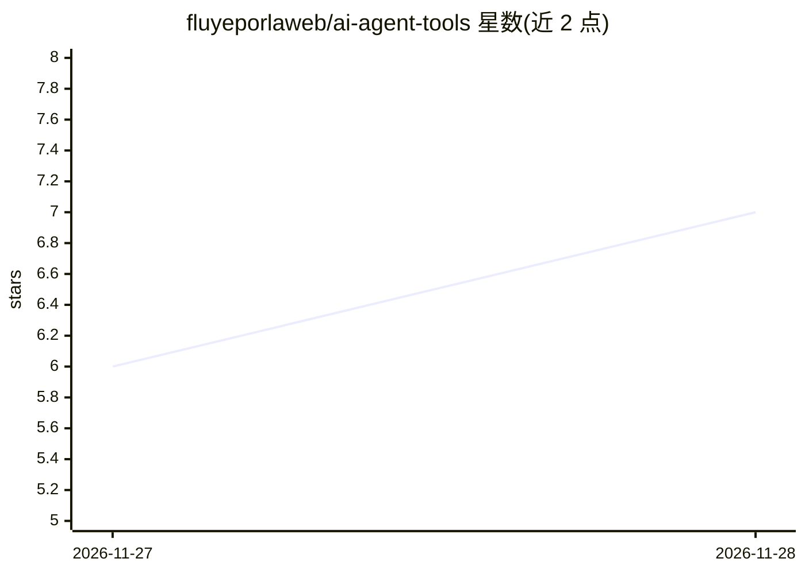

# fluyeporlaweb/ai-agent-tools

⭐ 7 · MIT · 推送 2026-11-27 · [GitHub](https://github.com/fluyeporlaweb/ai-agent-tools) · [官网](https://fluyeporlaweb.com) · 组织维护

**面向营销团队的 AI agent 工具策展清单**

由 fluyeporlaweb 维护的 awesome 型目录，收录面向营销与增长团队的开源 AI agent 工具，按协议标准、agent 框架与 SDK、编码 agent 与 IDE、MCP SDK 与注册表、MCP 服务器等章节组织。每条目附一行描述与链接，链接每周核查；带 affiliate 标记的推广链接单独标注。覆盖 LangChain、MCP 生态、Claude Code 等条目，支持英文与西班牙文双语。

## 筛选速览

| 维度 | 判定 | 备注 |
|---|---|---|
| AI 角色 | `ai-knowledge` | 知识聚合/清单类 |
| 许可风险 | `permissive` | MIT |
| 部署形态 | `library` | 以包/库形式分发 |
| 模型依赖 | — | README 未给出锁定关系 |
| 硬件要求 | — | 无带数字的原话,不猜 |
| 安装摩擦 | `medium` | 含编译或系统依赖之一 |
| 成熟度 | — | 结构信号不足 |

## 能力要点

- 按章节组织的开源 agent 工具目录：框架/编码 agent/MCP 服务器等
- 收录 MCP 协议规范与十余种官方 MCP SDK 条目
- 链接每周核查，条目附一行描述
- 提供英文与西班牙文双语版本

## 适用场景

- 为营销与增长团队挑选合适的 agent 框架或工作流工具
- 查找某类服务的官方 MCP 服务器接入入口
- 了解 MCP/Agent Skills 等协议与标准生态

## 场景标签

`精选清单` · 领域:学习与行业

## 证据(README 行号)

> L5: **A curated directory of open-source AI agent tools** for marketing and technical growth teams: **agent frameworks**
> L18: This is a curated awesome list of **open-source AI agent tools for marketing and growth teams**: frameworks and SDK

## 星数曲线

2026-11-27 6 → 2026-11-28 7（+1）

---
*卡片 v1 · prompt 1.4 · 生成 2026-11-27 · 置信度 mid · 依据 README sha `605e92423076` · [字段定义](../../DATASET.md)*
