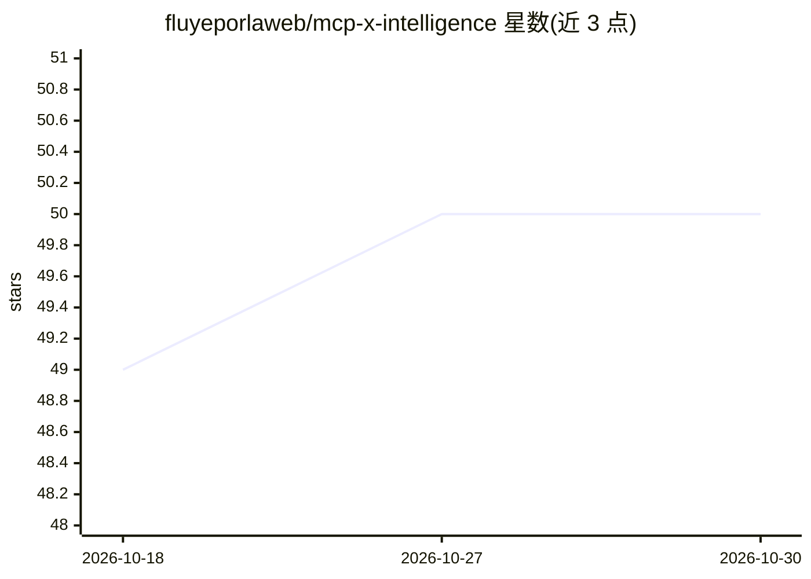

# fluyeporlaweb/mcp-x-intelligence

⭐ 50 · TypeScript · 推送 2026-08-17 · [GitHub](https://github.com/fluyeporlaweb/mcp-x-intelligence) · 个人维护

**面向 Claude/Cursor 等 AI agent 的 X/Twitter 只读研究 MCP 服务器**

基于 twitterapi.io 的 MCP 服务器，向 Claude Desktop、Cursor、Windsurf、Cline 等 MCP 客户端提供 4 个 X 研究工具：按关键词与互动阈值搜索病毒式内容、账号画像与互动率分析、按国家查询实时趋势、按领域发现头部账号。仅只读，不发帖不私信。使用方式有二：MCPize 托管版（免费 50 次/月或 $9/月 1000 次），或 BYOK 模式自带 twitterapi.io key 接入作者托管的端点，均无需本地部署；README 未提供本地源码运行方式。

## 筛选速览

| 维度 | 判定 | 备注 |
|---|---|---|
| AI 角色 | `ai-ecosystem` | LLM/agent 周边工具 |
| 许可风险 | `permissive` | — |
| 部署形态 | `None` |  |
| 模型依赖 | — | README 未给出锁定关系 |
| 硬件要求 | — | 无带数字的原话,不猜 |
| 安装摩擦 | `low` | 无编译、无系统依赖或容器化 |
| 成熟度 | — | 结构信号不足 |

## 能力要点

- 4 个工具：病毒内容搜索、账号分析、趋势查询、领域头部账号发现
- 支持全部主流 MCP 客户端（Claude Desktop/Code、Cursor、Windsurf、Cline、Codex CLI、Gemini CLI）
- 托管版免配置，或 BYOK 自带 twitterapi.io key 免服务器部署
- 纯只读研究，不涉及发帖与私信

## 适用场景

- 内容创作者在写帖前查找领域内正在走热的内容
- 营销人员做竞品账号分析与实时趋势监控
- 研究者在不使用官方 X API 的情况下采集社交媒体数据
- 开发者用实时 X 数据构建研究与内容策略流程

## 场景标签

`网页抓取` `数据分析` · 领域:效率与自动化

## 证据(README 行号)

> L5: Search viral content, analyze X accounts, track trending topics and discover niche leaders — directly from Claude, C
> L13: ## What it does — 4 X Research Tools for AI Agents
> L24: Claude Desktop · Claude Code · Cursor · Windsurf · Cline · Codex CLI · Gemini CLI · any MCP-compatible AI agent

## 星数曲线

2026-10-18 49 → 2026-10-30 50（+1）

---
*卡片 v1 · prompt 1.4 · 生成 2026-10-24 · 置信度 high · 依据 README sha `fa121dfeb030` · [字段定义](../../DATASET.md)*
