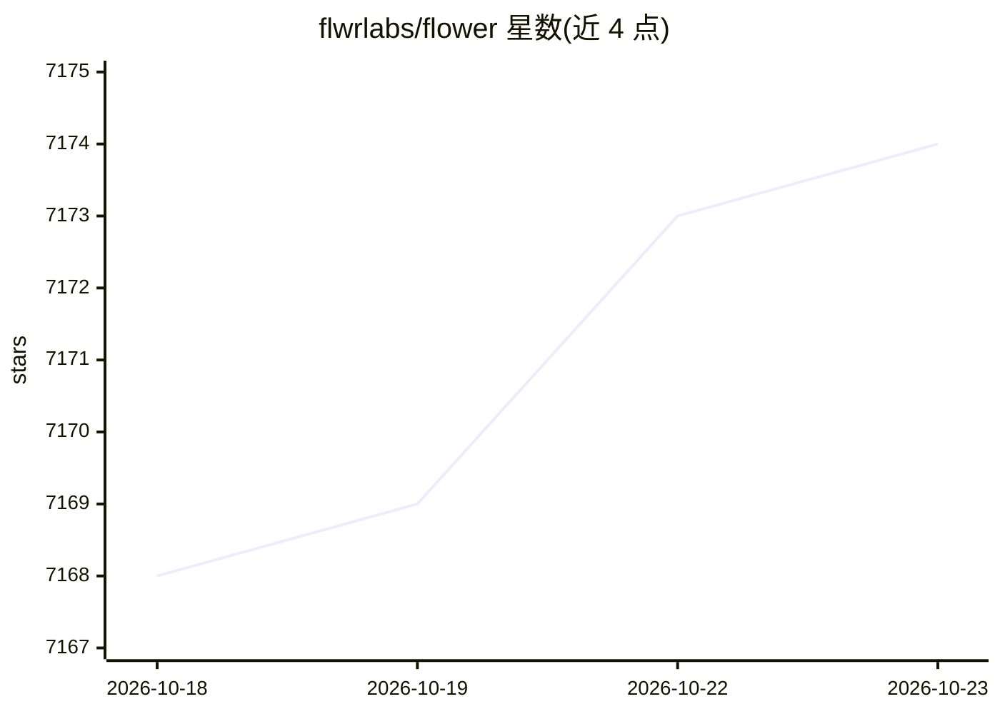

# flwrlabs/flower

⭐ 7,174 · Python · Apache-2.0 · 推送 2026-10-22 · [GitHub](https://github.com/flwrlabs/flower) · [官网](https://flower.ai) · 组织维护

**面向研究者的联邦学习框架：用任意 ML 框架构建联邦 AI 系统**

Flower（flwr）是一个用于构建联邦学习/联邦分析系统的框架，起源于牛津大学研究项目。核心机制为框架无关：可与 PyTorch、TensorFlow、Hugging Face、scikit-learn、JAX、TFLite（Android）、CoreML（iOS）、XGBoost 等多种 ML 框架配合使用，支持自定义联邦策略、自定义消息通信与组件扩展。面向 AI 研究者与开发者，提供系列入门教程、复现联邦学习论文的 Baselines 集合（FedAvg、FedProx、MOON 等）及大量代码示例，含 Raspberry Pi/Nvidia Jetson 边缘设备教程与 LLM/Whisper 联邦微调示例。

## 筛选速览

| 维度 | 判定 | 备注 |
|---|---|---|
| AI 角色 | `ai-ecosystem` | LLM/agent 周边工具 |
| 许可风险 | `permissive` | Apache-2.0 |
| 部署形态 | `None` |  |
| 模型依赖 | — | README 未给出锁定关系 |
| 硬件要求 | — | 无带数字的原话,不猜 |
| 安装摩擦 | `low` | 无编译、无系统依赖或容器化 |
| 成熟度 | — | 结构信号不足 |

## 能力要点

- 框架无关：支持 PyTorch/TensorFlow/JAX/scikit-learn 等十余种 ML 框架
- 联邦策略可自定义、组件可扩展覆盖
- Flower Baselines 复现 20+ 篇联邦学习论文实验
- 支持 Android（TFLite）与 iOS（CoreML）移动端快速上手

## 适用场景

- 用现有 ML 训练代码搭建联邦学习系统
- 复现或对比联邦学习论文中的算法基线
- 在移动与边缘设备上运行联邦学习实验
- 对 LLM/Whisper 等模型做联邦微调

## 场景标签

`模型训练` · 领域:训练与推理

## 证据(README 行号)

> L19: Flower (`flwr`) is a framework for building federated AI systems. The
> L30: - **Framework-agnostic**: Different machine learning frameworks have different
> L26: - **Extendable**: Flower originated from a research project at the University of

## 星数曲线

2026-10-18 7,168 → 2026-10-23 7,174（+6）

---
*卡片 v1 · prompt 1.4 · 生成 2026-10-20 · 置信度 high · 依据 README sha `e87035ab5593` · [字段定义](../../DATASET.md)*
