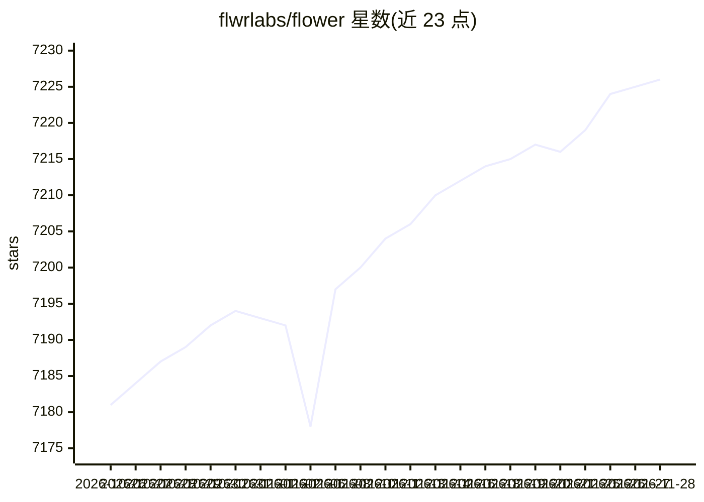

# flwrlabs/flower

⭐ 7,226 · Python · Apache-2.0 · 推送 2026-11-27 · [GitHub](https://github.com/flwrlabs/flower) · [官网](https://flower.ai) · 组织维护

**面向构建联邦 AI 系统的开源框架**

Flower（flwr）是一个用于构建联邦 AI 系统的框架，源自牛津大学研究项目。设计原则包括可定制（支持按用例配置联邦学习系统）、可扩展（组件可被覆盖以构建新系统）与框架无关（可配合 PyTorch、TensorFlow、JAX 等多种 ML 框架使用）。提供联邦学习入门系列教程、文档与 Quickstart（含 Android/iOS），以及社区贡献的 Baselines 集合，用于复现已发表的联邦学习实验，便于研究者在之上评估新方法。

## 筛选速览

| 维度 | 判定 | 备注 |
|---|---|---|
| AI 角色 | `ai-ecosystem` | LLM/agent 周边工具 |
| 许可风险 | `permissive` | Apache-2.0 |
| 部署形态 | `None` |  |
| 模型依赖 | — | README 未给出锁定关系 |
| 硬件要求 | — | 无带数字的原话,不猜 |
| 安装摩擦 | `low` | 无编译、无系统依赖或容器化 |
| 成熟度 | — | 结构信号不足 |

## 能力要点

- 框架无关：可配合 PyTorch、TensorFlow、Hugging Face、JAX、XGBoost 等
- Flower Baselines 收录 20+ 个复现联邦学习论文实验的社区项目
- 提供联邦学习入门教程系列与多框架 Quickstart 示例
- 支持 Android（TFLite）与 iOS（CoreML）端联邦学习示例

## 适用场景

- 跨设备/跨机构场景下搭建联邦学习系统
- 研究者在 Baselines 基础上评估新的联邦学习策略
- 在 Android/iOS 设备上运行联邦学习示例
- 对大语言模型或视觉模型做联邦微调

## 场景标签

 · 领域:机器学习/联邦学习框架

## 证据(README 行号)

> L19: Flower (`flwr`) is a framework for building federated AI systems. The
> L30: - **Framework-agnostic**: Different machine learning frameworks have different

## 星数曲线

2026-10-26 7,181 → 2026-11-28 7,226（+45）

---
*卡片 v1 · prompt 1.4 · 生成 2026-11-26 · 置信度 high · 依据 README sha `167c96af59a1` · [字段定义](../../DATASET.md)*
